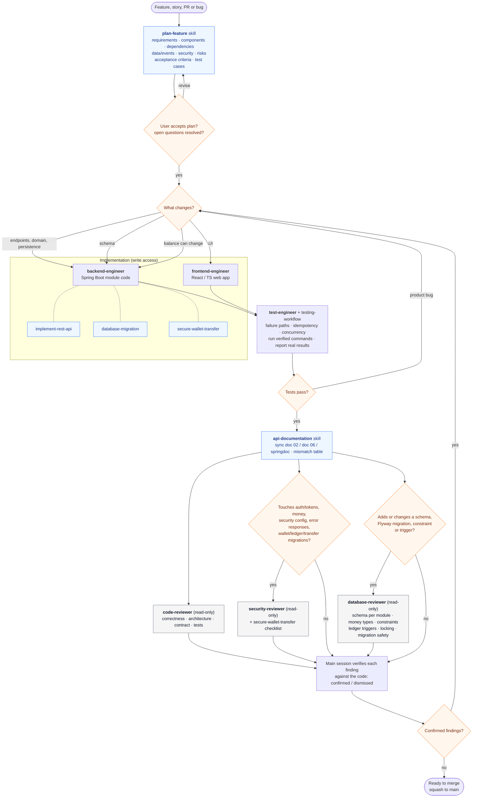
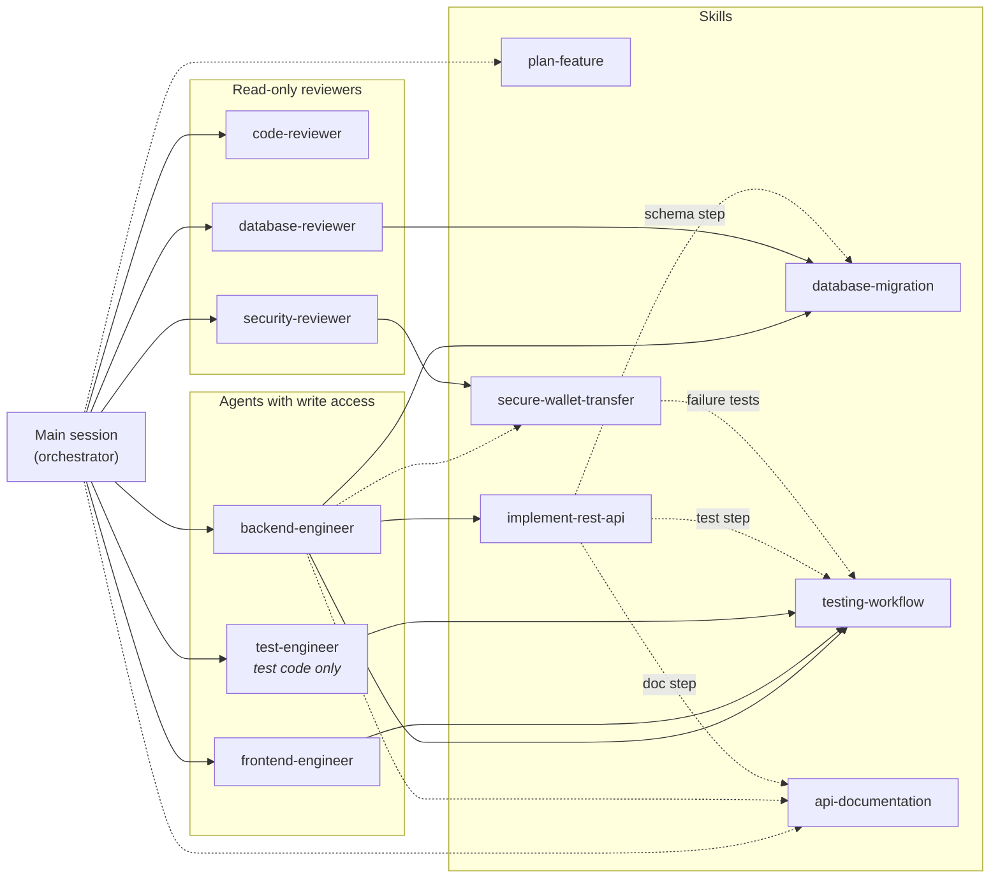

# Claude Code workflow: agents and skills

How work moves through the project agents (`.claude/agents/`) and skills (`.claude/skills/`). Rules behind the gates are in `CLAUDE.md` → "Agents and Skills".

## 1. Delivery workflow

## 2. Responsibility map

Solid arrow = skill preloaded into the agent. Dashed arrow = invoked when the task needs it.

## 3. Who owns what

| Agent | Can edit | Owns | Hands off to |
| --- | --- | --- | --- |
| `backend-engineer` | backend module code, migrations, tests | endpoints, DTOs, validation, authorisation, persistence, atomic money paths | `test-engineer`, reviewers |
| `frontend-engineer` | web app code and tests | screens, typed API client, UI states, accessibility | `test-engineer`, `code-reviewer` |
| `test-engineer` | test code only | test plan, coverage of rules and failure paths, real results | implementer (product bugs) |
| `code-reviewer` | nothing | correctness, module boundaries, contract, test gaps | `security-reviewer` for security issues |
| `security-reviewer` | nothing | auth, ownership, money integrity, web surface, data exposure | main session (verify findings) |
| `database-reviewer` | nothing | schema per module, keys, money types, constraints, indexes, ledger and audit triggers, locking support, idempotency tables, migration safety | main session (verify findings), `backend-engineer` for fixes |

| Skill | Used when | Produces |
| --- | --- | --- |
| `plan-feature` | before any feature, PR, cross-module or money-path change | plan + open questions; no code |
| `implement-rest-api` | an endpoint is added, changed or removed | endpoint + tests + doc update |
| `database-migration` | schemas, tables, constraints, indexes, triggers change | new Flyway migration + migration tests |
| `secure-wallet-transfer` | a balance can change (build or review) | rules ↔ tests + unresolved risks |
| `testing-workflow` | any code change or results to report | commands run + actual results |
| `api-documentation` | contract or event change, or a docs audit | updated docs + mismatch table |

## 4. Approval gates

| Gate | Who decides | Trigger |
| --- | --- | --- |
| Plan acceptance | user | every planned feature |
| Docs silent or conflicting, or a doc 06 deviation needed | user | any undefined financial, security or compliance value |
| Destructive or long-locking migration | user | drop/rename/narrow, data deletion, ledger trigger/grants, hot-table locks |
| New or upgraded dependency or infrastructure | user | any (doc 06 excludes Kafka, Redis, gateway, service discovery, mTLS) |
| Security review | required | auth/tokens/OTP, RBAC/ownership, money, security config, error responses, wallet/ledger/transfer migrations |
| Database review | required | any new or changed Flyway migration, schema, constraint, index or trigger; data-requirement extraction (documentations/07) |
| Findings | main session | each finding re-checked against code before fixing |
| Commit, push, merge, deploy | user | always explicit approval |
