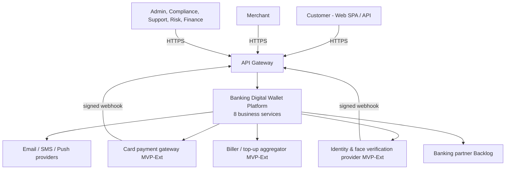
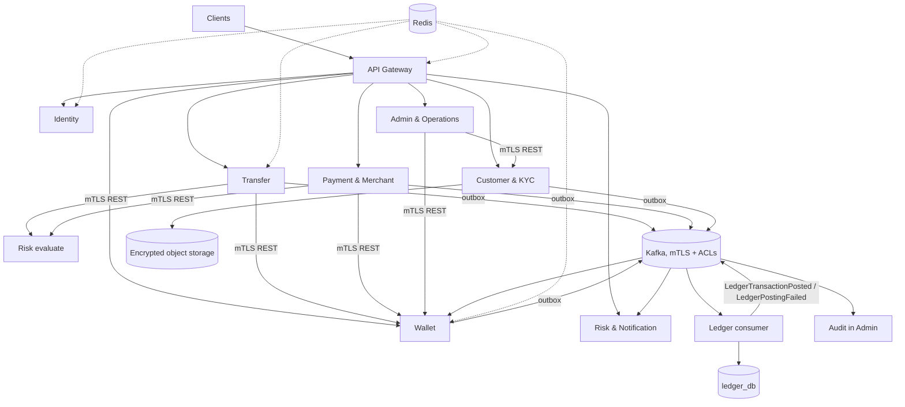
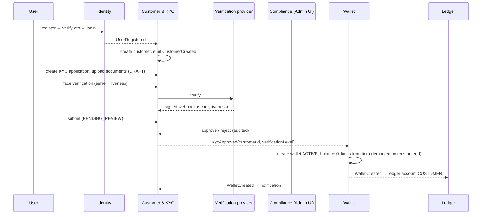
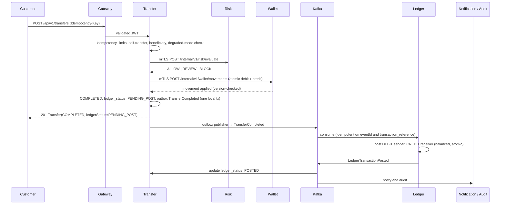
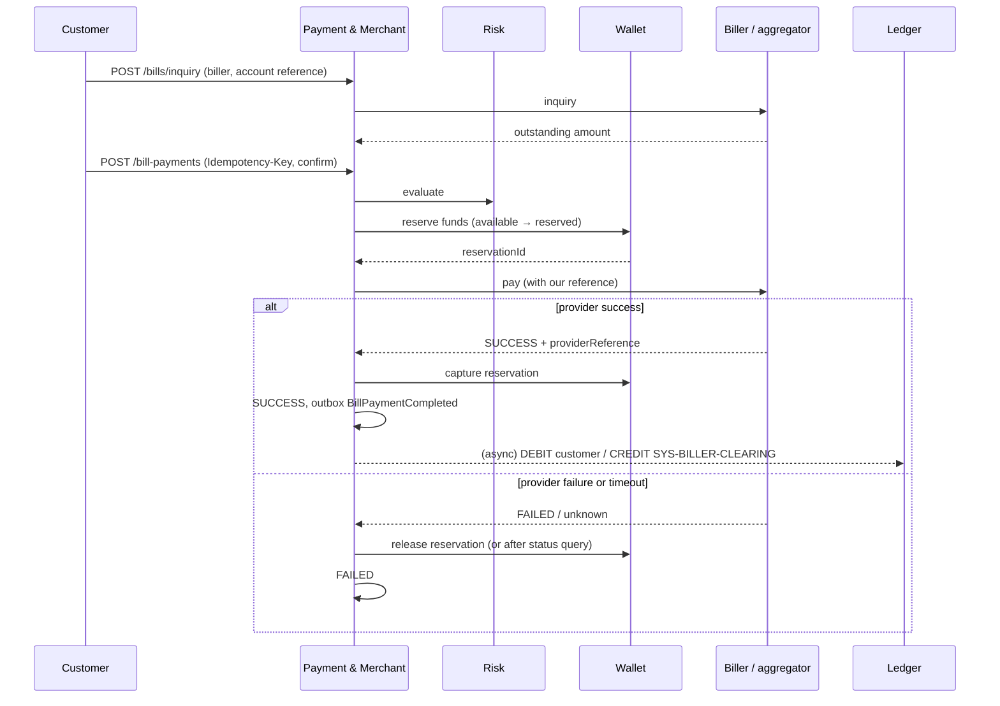

# High-Level Architecture Documentation
**Banking Digital Wallet Platform — System Architecture Document (SAD), Ledger & Accounting Design, Data Models, Integration Architecture**

> **Scope note:** This document describes the **long-term target architecture**. The portfolio MVP deliberately deviates from it in places; every approved deviation is recorded in [`06. PortfolioMvpDecisions.md`](06.%20PortfolioMvpDecisions.md), which governs the MVP where the two conflict.
---

## 1. Purpose, scope and context

A secure, cloud-native digital wallet for customers and merchants: registration with OTP, KYC with document and face verification, wallet, deposit (bank and linked card) and withdrawal, P2P transfer, merchant/QR payment, bill payment and mobile top-up, refunds, notifications, fraud screening, and a back office with RBAC, maker-checker and audit.

**Technical goals** (`01`, `02`): 1M users, thousands of TPS (target 5,000), 99.99% availability, API p95 < 200 ms, event-driven, horizontally scalable, banking-grade security.

**Out of the first demo:** native mobile apps, multi-currency, international remittance, loans, savings, crypto, BNPL, Open Banking, virtual cards.

### 1.1 Source-of-truth hierarchy
1. `FInal/01`, `FInal/02`, `FInal/03` — Final architecture, ERD, OpenAPI.
2. This document set, **for the decisions in §0 only**.
3. `16`, `13`, `18`, then product/domain docs `01`–`10`, then working papers `11/01`–`11/04`.

### 1.2 System context


---

## 2. Architecture style and principles

| Principle | Statement |
| --------- | --------- |
| DDD | 15 sub-domains grouped into 8 deployable bounded contexts (ADR-001) |
| Microservices | Independent deploy and scale; no modular monolith; no ninth "transaction service" (ADR-002) |
| Clean Architecture | `presentation → application → domain ← infrastructure` in every service (ADR-003) |
| Database-per-service | No cross-service joins or foreign keys (ADR-004) |
| REST + Kafka | REST for answers the caller needs now; Kafka for side effects **and ledger posting** (ADR-005 as amended by ADR-010) |
| Transactional outbox | Local write and outbox row in one DB transaction (ADR-006) |
| No 2PC | Local commits, compensation and eventual consistency (ADR-007) |
| JWT at Gateway | Single enforcement point; services still apply `@PreAuthorize` (ADR-008) |
| Optimistic locking | `wallets.version` prevents lost updates (ADR-009) |
| Mutual TLS | Every service-to-service hop is authenticated by certificate (ADR-011) |
| Reserve-then-capture | Flows that depend on an external provider reserve funds first (ADR-012) |
| Idempotency | `Idempotency-Key` on money POSTs; `eventId` de-duplication on consumers |

### 2.1 ADR additions 
| ID | Decision | Status | Rationale |
| -- | -------- | ------ | --------- |
| ADR-010 | Ledger entries are posted asynchronously by a Ledger consumer of outbox events; ledger status is visible on business records; reconciliation and degraded mode protect consistency | Accepted | Keeps the money path short and independent of Ledger availability; matches `FInal/02` §3 and `11/04` |
| ADR-011 | Mutual TLS between all services, Kafka mTLS + ACLs, allow-list per internal path | Accepted | Zero-trust internal network; internal APIs never trust end-user tokens |
| ADR-012 | Reserve-then-capture for flows that depend on an external provider (bill payment, top-up) | Accepted | Failed provider calls must never leave a wrong debit (BR §14); uses `reserved_balance` |
| ADR-013 | Wallet is created by Wallet service on consuming `KycApproved` (idempotent on customer id) | Accepted | Owner decision D-03; keeps the Wallet context free of Customer queries |

---

## 3. Service map

### 3.1 Business services (8) and infrastructure (3)

| # | Component | Responsibility | Data store | Public paths |
| - | --------- | -------------- | ---------- | ------------ |
| 1 | Identity | Register, login, JWT, refresh, OTP, sessions, passwords | `identity_db` | `/api/v1/auth/**` |
| 2 | Customer & KYC | Profile, KYC applications, documents, **face verification** [MVP-Ext] | `customer_db` | `/api/v1/customers/**`, `/api/v1/kyc/**`, `/api/v1/webhooks/kyc-provider` |
| 3 | Wallet | Wallet, balance snapshot, deposit, withdrawal, limits, freeze, **reservations** | `wallet_db` | `/api/v1/wallet/**` |
| 4 | Transfer | P2P transfers, beneficiaries, idempotency | `transfer_db` | `/api/v1/transfers/**`, `/api/v1/beneficiaries/**` |
| 5 | Payment & Merchant | Merchants, payments, QR, refunds, **linked cards, bill payment, top-up** [MVP-Ext] | `payment_db` | `/api/v1/merchants/**`, `/api/v1/payments/**`, `/api/v1/cards/**`, `/api/v1/billers/**`, `/api/v1/bills/**`, `/api/v1/bill-payments/**`, `/api/v1/webhooks/payment-gateway` |
| 6 | Ledger | Double-entry accounting; system of record for money | `ledger_db` | internal only |
| 7 | Risk & Notification | Risk evaluate, fraud alerts; notifications, preferences | `risk_db`, `notification_db` | `/api/v1/notifications/**`, `/api/v1/notification-preferences` |
| 8 | Admin & Operations | RBAC, approvals, audit, dashboards, back-office operations | `admin_db` | `/api/v1/admin/**` |
| 9 | API Gateway | Routing, JWT validation, rate limiting, CORS, correlation ID | — | all public |
| 10 | Config Server | Central configuration (local); ConfigMaps in production (D-10) | — | internal |
| 11 | Service Discovery | Eureka locally; Kubernetes DNS in production | — | internal |

Shared infrastructure: PostgreSQL (one database per service), Kafka, Redis, object storage for KYC files (encrypted S3 bucket, [MVP-Ext]).

### 3.2 Gateway routing (complete)
```
/api/v1/auth/**                  → Identity
/api/v1/customers/**             → Customer & KYC
/api/v1/kyc/**                   → Customer & KYC
/api/v1/webhooks/kyc-provider    → Customer & KYC     (public, HMAC-verified, no JWT)
/api/v1/wallet/**                → Wallet
/api/v1/transfers/**             → Transfer
/api/v1/beneficiaries/**         → Transfer
/api/v1/payments/**              → Payment & Merchant
/api/v1/merchants/**             → Payment & Merchant
/api/v1/cards/**                 → Payment & Merchant
/api/v1/billers/**               → Payment & Merchant
/api/v1/bills/**                 → Payment & Merchant
/api/v1/bill-payments/**         → Payment & Merchant
/api/v1/webhooks/payment-gateway → Payment & Merchant (public, HMAC-verified, no JWT)
/api/v1/notifications/**         → Risk & Notification
/api/v1/notification-preferences → Risk & Notification
/api/v1/admin/**                 → Admin & Operations
/internal/v1/**                  → NOT ROUTED
```

### 3.3 Container view


### 3.4 Inside a service (Clean Architecture)
```
presentation   Controllers, DTOs, exception mapping       → application only
application    Use cases, ports in/out, mappers           → domain only
domain         Entities, value objects, rules, events     → nothing (no Spring/JPA/Kafka)
infrastructure JPA adapters, Kafka, Redis, REST clients   → implements ports
```
Package convention `com.platform.<service>.{domain,application,infrastructure,presentation,config,security}`. Flyway scripts in `src/main/resources/db/migration`, one stream per database.

---

## 4. Runtime views

### 4.1 Onboarding and wallet creation (D-03)

Before approval the customer has **no wallet**: `GET /api/v1/wallet` returns `404 WALLET_NOT_FOUND` and money endpoints return `403 KYC_REQUIRED`. A later `KycApproved` with a higher `verificationLevel` upgrades limits on the existing wallet.

### 4.2 P2P transfer (asynchronous ledger)


| Failure point | Result |
| ------------- | ------ |
| Validation, limit, idempotency conflict | 4xx; no balance change |
| Risk `BLOCK` | transfer `FAILED` (`RISK_BLOCKED`); fraud alert possible; balances untouched |
| Wallet movement fails atomically | transfer `FAILED`; nothing to compensate |
| Transfer crashes after wallet movement | recovery job (RB-6) finds `PROCESSING` transfers, queries Wallet by reference, completes or compensates |
| Ledger consumer down | wallet already correct; `ledgerStatus` stays `PENDING_POST`; lag alert; degraded mode after 5 min (D-13) |
| Poison event | retries → DLQ → replay; `LedgerPostingFailed` sets `FAILED_POST`; reconciliation flags it |

### 4.3 Deposit and withdrawal
- **Withdrawal:** `POST /wallet/withdrawals` → validate (wallet active, KYC level, amount > 0, limits, no overdraft) → snapshot update with optimistic `version` → `withdrawals` row + outbox `MoneyWithdrawn` in one local transaction → Ledger posts DEBIT customer / CREDIT `SYS-CASH-CLEARING`.
- **Deposit, bank/manual:** same pattern with `MoneyDeposited`; DEBIT `SYS-CASH-CLEARING` / CREDIT customer.
- **Deposit by linked card [MVP-Ext]:** `POST /wallet/deposits` with `fundingSource {type: CARD, cardId}` → deposit `PENDING` → Wallet calls Payment & Merchant (mTLS) to authorise the card through the gateway → gateway confirms by signed webhook → deposit `COMPLETED`, snapshot credited, `MoneyDeposited` emitted. Declined → `FAILED` with no balance change.

### 4.4 Merchant / QR payment
`POST /payments/qr/scan` → QR must be `ACTIVE`, unexpired, merchant approved → customer reviews → `POST /payments/qr/confirm` (Idempotency-Key) → Payment: risk evaluate → Wallet movement (customer debit / merchant credit) → payment `COMPLETED`, `ledger_status=PENDING_POST`, outbox `PaymentCompleted` → Ledger posts DEBIT customer / CREDIT merchant.

### 4.5 Bill payment and mobile top-up [MVP-Ext] (ADR-012)

A timeout is treated as *unknown*: the reservation stays held while Payment queries the provider with the original reference (bounded retries); only a confirmed result captures or releases. This satisfies BR §14: a failed provider call never leaves a wrong debit.

### 4.6 Refund
`POST /payments/{id}/refunds` (Idempotency-Key) → payment must be `COMPLETED`, refund ≤ original less prior refunds → approval via maker-checker when policy requires → Wallet movement (merchant debit / customer credit) → refund `COMPLETED`, outbox `RefundCompleted` → Ledger posts DEBIT merchant / CREDIT customer as a separate linked transaction.

---

## 5. Communication and event architecture

### 5.1 Synchronous (REST, mutual TLS)
| Caller → Callee | Purpose |
| --------------- | ------- |
| Gateway → services | public API |
| Transfer, Payment → Risk `/internal/v1/risk/evaluate` | pre-authorisation fraud check |
| Transfer, Payment → Wallet `/internal/v1/wallet/**` | atomic movement, reservations, compensation |
| Wallet → Payment `/internal/v1/cards/authorize` | card-funded deposit [MVP-Ext] |
| Admin → Wallet, Customer & KYC (internal) | freeze/unfreeze, KYC decisions, limit changes |
| Business services → Ledger | **reads and reversals only**; posting is event-driven (ADR-010) |

### 5.2 Asynchronous (Kafka)
Topics: `identity.events`, `customer.events`, `wallet.events`, `transfer.events`, `payment.events`, `ledger.events`, `risk.events`, `notification.events`, `admin.events`, each with a `.dlq`. Consumer groups: `ledger-service`, `notification-service`, `audit-service`, `risk-service`, `wallet-service` (for `KycApproved`), and per-service status updaters for `ledger.events`.

Envelope (all events):
```json
{ "eventId": "uuid", "eventType": "TransferCompleted", "eventVersion": 1,
  "occurredAt": "2026-08-24T10:00:00Z", "producer": "transfer-service",
  "correlationId": "uuid", "causationId": "uuid", "payload": {} }
```
Rules: immutable, past tense, unique `eventId`, versioned, no secrets or personal data beyond IDs, `correlationId` end to end. In staging and production events are HMAC-signed by the producer.

### 5.3 Ledger-relevant events
| Event | Producer | Ledger action |
| ----- | -------- | ------------- |
| `WalletCreated` | Wallet | create ledger account `CUSTOMER` (also created lazily on first posting from event data) |
| `MerchantApproved` | Payment | create ledger account `MERCHANT` |
| `MoneyDeposited` | Wallet | DEBIT `SYS-CASH-CLEARING` / CREDIT customer |
| `MoneyWithdrawn` | Wallet | DEBIT customer / CREDIT `SYS-CASH-CLEARING` |
| `TransferCompleted` | Transfer | DEBIT sender / CREDIT receiver |
| `PaymentCompleted` | Payment | DEBIT customer / CREDIT merchant |
| `RefundCompleted` | Payment | DEBIT merchant / CREDIT customer |
| `BillPaymentCompleted` [MVP-Ext] | Payment | DEBIT customer / CREDIT `SYS-BILLER-CLEARING` |
| `TransferReversed`, `PaymentReversed` | Transfer, Payment | reversal transaction |
| `LedgerTransactionPosted`, `LedgerTransactionReversed`, `LedgerPostingFailed` | Ledger | emitted; consumed by Audit and by owning services to set `ledger_status` |

New events for MVP-Ext: `KycFaceVerified`, `KycFaceVerificationFailed`, `CardLinked`, `CardRemoved`, `BillPaymentInitiated`, `BillPaymentCompleted`, `BillPaymentFailed`, `LedgerPostingFailed`, `WalletLimitsChanged`. Full catalog: `11/04. EventDesign.md` plus these.

### 5.4 Reliability patterns
- **Outbox publisher:** drains `outbox_events WHERE published = false` with `FOR UPDATE SKIP LOCKED`; at-least-once.
- **Idempotent consumers:** `processed_events(event_id PK, consumer, processed_at)` per consuming service.
- **Retry and DLQ:** exponential backoff, five attempts, then `<topic>.dlq`; operator replay tool.
- **Ordering:** message key = aggregate id (wallet, transfer, payment).
- **Ledger posting guard:** before posting, the Ledger consumer validates the event came from the owning producer (Kafka ACL principal) and that amounts are positive and balanced.

---

## 6. Ledger & accounting design

### 6.1 Role
Ledger is the **accounting system of record**; Wallet is the **operational snapshot**. If they disagree, Ledger wins and the discrepancy is handled by reconciliation (§6.6).

| Store | Holds | Mutability |
| ----- | ----- | ---------- |
| `wallet_db.wallets` | `available_balance`, `reserved_balance`, `version` | updated in place; CHECK ≥ 0 |
| `ledger_db.ledger_entries` | immutable debit and credit rows | append-only; corrections by reversal |

### 6.2 Sign convention
For customer and merchant accounts, **CREDIT increases** the holder's balance and **DEBIT decreases** it. Ledger balance = Σ CREDIT − Σ DEBIT, always derived from entries.

### 6.3 Accounts
Types: `CUSTOMER`, `MERCHANT`, `SYSTEM`, `FEE`, `SUSPENSE`. Seeded system accounts: `SYS-CASH-CLEARING` (bank and card funds in and out), `SYS-BILLER-CLEARING` (bill and top-up settlement), `SYS-FEE`, `SYS-SUSPENSE`.

### 6.4 Posting templates
| Type | DEBIT | CREDIT | Source event |
| ---- | ----- | ------ | ------------ |
| DEPOSIT | `SYS-CASH-CLEARING` | customer | `MoneyDeposited` |
| WITHDRAWAL | customer | `SYS-CASH-CLEARING` | `MoneyWithdrawn` |
| TRANSFER | sender | receiver | `TransferCompleted` |
| PAYMENT | customer | merchant | `PaymentCompleted` |
| REFUND | merchant | customer | `RefundCompleted` |
| BILL_PAYMENT [MVP-Ext] | customer | `SYS-BILLER-CLEARING` | `BillPaymentCompleted` |
| REVERSAL | original credit accounts | original debit accounts | reversal request |
| FEE [Backlog] | payer | `SYS-FEE` | fee-bearing events |

Example: transfer of 10,000 THB → `sender DEBIT 10,000` / `receiver CREDIT 10,000`.
`LedgerPostingRequest.transactionType` enum is extended with `BILL_PAYMENT`.

### 6.5 Invariants
1. Per financial transaction: Σ DEBIT = Σ CREDIT, at least two entries.
2. Amount > 0; currency explicit; THB only in MVP.
3. Entries are immutable; the application DB role has no UPDATE or DELETE on `ledger_entries`.
4. `transaction_reference` is unique, so replays are idempotent: a duplicate event returns the existing transaction.
5. Each posting is one DB transaction.
6. Accounts in `FROZEN` or `CLOSED` state reject new entries (the event fails to `FAILED_POST` and raises an alert; wallet freeze is the control for blocking customers).
7. Corrections are a `REVERSALS` row plus a new offsetting transaction.

### 6.6 Consistency model and reconciliation
```
t0        Wallet snapshot updated; business record COMPLETED; ledger_status = PENDING_POST
t0 + ε    outbox → Kafka
t0 + δ    Ledger posts entries → LedgerTransactionPosted → ledger_status = POSTED
```
- **Business meaning:** `COMPLETED` = wallet movement done. A transaction is *financially final* when `ledgerStatus = POSTED`.
- **Targets:** posting lag p95 < 5 s, p99 < 30 s; any unposted event older than 5 min is a P1.
- **Degraded mode (D-13):** automatic flag when lag > 5 min; transfers, payments, withdrawals and bill payments above 50,000 THB return `503 SERVICE_DEGRADED` with `Retry-After`; smaller amounts continue.
- **Reconciliation job (Sprint 4):** scheduled and repeatable; read-only on history. Compares per wallet `available_balance + reserved_balance` with the ledger-derived balance, and matches every deposit, withdrawal, transfer, payment, refund and bill payment with a ledger transaction. Output: `RECONCILED` or an exception record for investigation.
- Alert on any non-zero exception.

### 6.7 Compensation (no 2PC)
Wallet movements between two wallets are one atomic local transaction inside Wallet, so a transfer cannot be half-applied. Compensation is needed only when another service fails after Wallet succeeded (for example Transfer crashes before completing). `POST /internal/v1/wallet/compensations` reverses a movement by reference and is idempotent (`reference` + `-COMP`). No ledger event is emitted for a movement that was compensated before `COMPLETED`.

### 6.8 Concurrency
Snapshot updates use `UPDATE … WHERE id = ? AND version = ?`; zero rows updated means reload and bounded retry. Two-wallet movements lock in ascending wallet-id order. High-traffic merchant wallets use batched settlement postings in the Backlog to avoid hot rows.

---

## 7. Database & data models

### 7.1 Databases
`identity_db`, `customer_db`, `wallet_db`, `transfer_db`, `payment_db`, `ledger_db`, `risk_db`, `notification_db`, `admin_db` — PostgreSQL, Flyway per database, HikariCP.

### 7.2 Tables
| DB | Tables |
| -- | ------ |
| identity_db | `users`, `credentials`, `refresh_tokens`, `sessions`, `otp_verifications` |
| customer_db | `customers`, `kyc_applications`, `kyc_documents`, **`kyc_verifications`** [MVP-Ext], `processed_events` |
| wallet_db | `wallets`, `wallet_limits`, `deposits`, `withdrawals`, **`reservations`** [MVP-Ext], `outbox_events`, `processed_events` |
| transfer_db | `transfers`, `beneficiaries`, `idempotency_records`, `outbox_events`, `processed_events` |
| payment_db | `merchants`, `payments`, `qr_codes`, `refunds`, **`linked_cards`**, **`billers`**, **`bill_payments`** [MVP-Ext], `idempotency_records`, `outbox_events`, `processed_events` |
| ledger_db | `ledger_accounts`, `financial_transactions`, `ledger_entries`, `reversals`, `processed_events` |
| risk_db | `risk_assessments`, `fraud_alerts`, `processed_events` |
| notification_db | `notifications`, `notification_preferences`, `processed_events` |
| admin_db | `admin_users`, `roles`, `permissions`, `user_roles`, `role_permissions`, `audit_logs`, `approvals`, `processed_events` |

### 7.3 Schema delta to `FInal/02. ERD.md`
These changes are required by §0 decisions. Types follow existing conventions.

```sql
-- all services: consumer de-duplication
CREATE TABLE processed_events (
  event_id uuid PRIMARY KEY, consumer varchar(100) NOT NULL, processed_at timestamptz NOT NULL DEFAULT now());

-- ledger posting visibility (D-06): wallet_db.deposits/withdrawals, transfer_db.transfers,
-- payment_db.payments/refunds/bill_payments
ALTER TABLE transfers ADD COLUMN ledger_status varchar(20) NOT NULL DEFAULT 'PENDING_POST'
  CHECK (ledger_status IN ('PENDING_POST','POSTED','FAILED_POST'));
-- (same column on deposits, withdrawals, payments, refunds, bill_payments)

-- one primary wallet per customer (D-03, BR-005)
CREATE UNIQUE INDEX uq_wallets_customer ON wallets(customer_id);

-- idempotency hash is not a UUID
ALTER TABLE idempotency_records ALTER COLUMN request_hash TYPE varchar(64);

-- reservations (ADR-012)
CREATE TABLE reservations (
  id uuid PRIMARY KEY DEFAULT gen_random_uuid(),
  wallet_id uuid NOT NULL REFERENCES wallets(id),
  amount numeric(19,4) NOT NULL CHECK (amount > 0),
  currency char(3) NOT NULL,
  status varchar(20) NOT NULL CHECK (status IN ('HELD','CAPTURED','RELEASED','EXPIRED')),
  reference varchar(100) NOT NULL UNIQUE,
  expires_at timestamptz NOT NULL,
  created_at timestamptz NOT NULL DEFAULT now(), settled_at timestamptz);

-- face verification (customer_db)
CREATE TABLE kyc_verifications (
  id uuid PRIMARY KEY DEFAULT gen_random_uuid(),
  kyc_application_id uuid NOT NULL REFERENCES kyc_applications(id),
  verification_type varchar(20) NOT NULL CHECK (verification_type IN ('FACE_MATCH','LIVENESS','DOCUMENT')),
  provider varchar(50) NOT NULL, provider_reference varchar(100) NOT NULL,
  score numeric(5,4), result varchar(20) NOT NULL CHECK (result IN ('PENDING','PASS','MANUAL_REVIEW','FAIL')),
  attempt_no int NOT NULL, consent_at timestamptz NOT NULL,
  created_at timestamptz NOT NULL DEFAULT now(), completed_at timestamptz);

-- linked cards (payment_db): tokens only, never PAN or CVV
CREATE TABLE linked_cards (
  id uuid PRIMARY KEY DEFAULT gen_random_uuid(),
  customer_id uuid NOT NULL,
  gateway_token varchar(200) NOT NULL, brand varchar(20) NOT NULL, last4 char(4) NOT NULL,
  exp_month smallint NOT NULL, exp_year smallint NOT NULL,
  status varchar(20) NOT NULL CHECK (status IN ('ACTIVE','REMOVED','EXPIRED','BLOCKED')),
  created_at timestamptz NOT NULL DEFAULT now(), updated_at timestamptz NOT NULL DEFAULT now(),
  UNIQUE (customer_id, gateway_token));

-- billers and bill payments (payment_db)
CREATE TABLE billers (
  id uuid PRIMARY KEY DEFAULT gen_random_uuid(),
  code varchar(50) NOT NULL UNIQUE, name varchar(150) NOT NULL,
  category varchar(30) NOT NULL CHECK (category IN ('ELECTRICITY','WATER','INTERNET','MOBILE_TOPUP')),
  status varchar(20) NOT NULL CHECK (status IN ('ACTIVE','SUSPENDED')),
  created_at timestamptz NOT NULL DEFAULT now(), updated_at timestamptz NOT NULL DEFAULT now());
CREATE TABLE bill_payments (
  id uuid PRIMARY KEY DEFAULT gen_random_uuid(),
  customer_id uuid NOT NULL, biller_id uuid NOT NULL REFERENCES billers(id),
  account_reference varchar(100) NOT NULL,
  amount numeric(19,4) NOT NULL CHECK (amount > 0), currency char(3) NOT NULL,
  status varchar(20) NOT NULL CHECK (status IN ('PENDING','SUCCESS','FAILED')),
  reference varchar(100) NOT NULL UNIQUE, provider_reference varchar(100),
  reservation_id uuid, failure_reason text,
  ledger_status varchar(20) NOT NULL DEFAULT 'PENDING_POST',
  created_at timestamptz NOT NULL DEFAULT now(), completed_at timestamptz);

-- wallet_limits seeded from tier at wallet creation (D-05)
-- tier BASIC: daily_transfer 100000; VERIFIED: 500000; PREMIUM: 1000000
-- daily_withdrawal 50000 / daily_deposit 200000 / single_* unchanged from defaults

-- ledger account type already covers SYSTEM; add enum value BILL_PAYMENT to transaction_type validation
```
Ledger-side `ledger_accounts` for system accounts are seeded by a Flyway migration.

### 7.4 Key constraints
- Wallet: balances ≥ 0, status ∈ ACTIVE/FROZEN/CLOSED, `NUMERIC(19,4)`, currency THB in MVP (configuration check).
- Transfer: `amount > 0`, `sender_customer_id <> receiver_customer_id`, unique `reference` and `idempotency_key`.
- Beneficiary: unique `(customer_id, beneficiary_customer_id)`, not self.
- Ledger entry: `entry_type ∈ DEBIT/CREDIT`, `amount > 0`.
- Money in code is `BigDecimal`, never floating point.

### 7.5 Tier and limits mapping (D-05)
| Tier | KYC trigger | `daily_transfer` | Changed by |
| ---- | ----------- | ---------------- | ---------- |
| Basic | `KycApproved` with `BASIC` | 100,000 THB | automatic |
| Verified | `KycApproved` with `FULL` | 500,000 THB | automatic |
| Premium | admin decision | 1,000,000 THB | maker-checker approval (`WalletLimitsChanged`) |

Failed and cancelled transfers do not consume the daily limit. Limits are configuration, never hard-coded.

### 7.6 Cross-service logical references
| From | To | Resolved via |
| ---- | -- | ------------ |
| `customers.user_id` | `identity_db.users.id` | `UserRegistered` / `CustomerCreated` |
| `wallets.customer_id` | `customers.id` | `KycApproved` |
| `transfers.sender_wallet_id` | `wallets.id` | Wallet internal API at transfer time |
| `ledger_accounts.owner_reference` | wallet or merchant id | `WalletCreated` / `MerchantApproved` |
| `fraud_alerts.assigned_to` | `admin_users.id` | Admin API |
| `notifications.user_id` | `users.id` | event `userId` |
| `audit_logs.actor_id` | user or admin id | JWT claims |
| `linked_cards.customer_id`, `bill_payments.customer_id` | `customers.id` | JWT subject mapping / events |

### 7.7 Indexing and lifecycle
Indexes: wallets (customer unique, status), transfers (sender, receiver, status, created_at), ledger entries (transaction, account), audit logs (actor, resource, created_at), users (email, phone unique), bill payments (customer, status, created_at), linked cards (customer, status). Financial records are never physically deleted. Retention: 7 years for financial and audit data (D-08). Flyway migrations are append-only after merge.

---

## 8. Integration architecture

| Integration | Direction | Mechanism | Status |
| ----------- | --------- | --------- | ------ |
| Email, SMS, push providers | outbound | Notification adapters; retry then DLQ; failure never rolls back money | email [MVP]; SMS, push [Backlog] |
| **Card payment gateway** | outbound + signed inbound webhook | hosted fields tokenise the card in the browser; platform stores token only; authorise deposit; webhook confirms | [MVP-Ext] |
| **Identity & face verification provider** | outbound + signed inbound webhook | document check, liveness, face match; platform stores result, score and provider reference only | [MVP-Ext] |
| **Biller / top-up aggregator** | outbound | inquiry and pay APIs; our `reference` as idempotency token; status query on timeout | [MVP-Ext] |
| Banking partner (bank transfer) | outbound | adapter with external reference and PENDING/SUCCESS/FAILED | [Backlog] |
| Bank statement reconciliation | inbound | file or API import | [Backlog] |
| Web SPA | inbound | Gateway only | [MVP] demo |
| Observability stack | outbound | Prometheus scrape, JSON logs to ELK/OpenSearch, OpenTelemetry | see `22` |

Integration rules:
1. Every outbound call has a timeout, retry with backoff, a circuit breaker and an idempotency reference.
2. Adapters live in `infrastructure/client` behind application ports, so providers can be replaced.
3. Inbound webhooks bypass JWT but require HMAC signature verification, timestamp tolerance (5 min), replay protection (stored `providerEventId`) and an IP allow-list.
4. Provider payloads are never forwarded to Kafka; only normalised facts are.
5. Demo/staging use provider stubs implementing the same ports.

---

## 9. Service-to-service security (ADR-011)
- Every service has an X.509 identity (SPIFFE ID `spiffe://wallet.platform/<env>/<service>`), issued by an internal CA; certificates live ≤ 24 h in Kubernetes (service mesh automation) and 30 days in local Compose.
- All `/internal/v1/**` endpoints require a client certificate. An allow-list authorises *which service may call which path* (see `21` §3.6).
- Internal APIs do not trust end-user JWTs. The trusted caller passes explicit IDs (customerId, walletId, reference) and `X-Correlation-Id`; the callee enforces business rules on those IDs.
- Kafka uses TLS client certificates; ACLs restrict producers to their own topics and consumers to their groups.
- Gateway → services uses mTLS as well; databases, Redis and object storage use TLS with per-service credentials.

---

## 10. Technology stack
Java 21, Spring Boot 3.x (Web, Data JPA, Security, Validation, Actuator), Spring Cloud Gateway, Config Server, Eureka (local), PostgreSQL, Kafka (MSK), Redis, Maven, Docker/Compose, Kubernetes with a service mesh (mTLS), GitHub Actions, JUnit 5, Mockito, Testcontainers, k6/Gatling, Micrometer, Prometheus, Grafana, ELK/OpenSearch, OpenTelemetry, AWS (RDS, ElastiCache, MSK, EKS, S3, KMS), React + TypeScript + Vite (demo only).

## 11. Repository layout
```
banking-digital-wallet/
├── api-gateway/ identity-service/ customer-kyc-service/ wallet-service/
├── transfer-service/ payment-merchant-service/ ledger-service/
├── risk-notification-service/ admin-operations-service/
├── config-server/ discovery-server/ web-app/
├── infrastructure/{docker,kafka,postgres,redis,pki}/
└── docs/
```
`infrastructure/pki` holds the local dev CA and certificate generation scripts.

---

## 12. Required updates to source documents
| File | Update |
| ---- | ------ |
| `FInal/01` | §5 sequence and ADR-005/006 wording → async ledger; add ADR-010…013; §4 routing table; §8 mTLS; service list notes for MVP-Ext |
| `FInal/02` | apply §7.3 schema delta; §3 note on ledger reconciliation stays valid |
| `FInal/03` | add endpoints in `20` §3 and §7; `ledgerStatus`; `resend-otp` body; `BILL_PAYMENT`; internal wallet API |
| `13`, `18` | Sprint 2 face verification; Sprint 3 consumer-based ledger and wallet-on-KYC; Sprint 4 reconciliation; Sprint 5 cards; new Sprint 7 |
| `15`, `16` | "Money movement" sections; Compose adds `pki` and provider stubs |
| `09` | §16 ledger rule; §7/§8 limits; wallet creation after KYC; §14 reservation rule |
| `02`, `04` | FR-009 and US-019 wallet creation timing |
| `05` | story/sprint re-sequencing (bill payment, KYC documents) |

## 13. Known documentation defects (handled in this set)
| # | Where | Defect | Handling |
| - | ----- | ------ | -------- |
| 1 | `FInal/02` `idempotency_records.request_hash` | typed `uuid` | `varchar(64)` |
| 2 | `11/02` Refund API block | repeats QR endpoints | OpenAPI `/payments/{id}/refunds` |
| 3 | `FInal/01` §4 | routing table incomplete | §3.2 |
| 4 | `11/03` SQL | currency check allows THB, USD, EUR, JPY | THB only in MVP |
| 5 | Backlog KYC states | `PENDING` vs OpenAPI `DRAFT/PENDING_REVIEW` | OpenAPI values |
| 6 | `11/04` | `KYCApproved` heading | `KycApproved` |
| 7 | `10` | `recipientId`, `/admin/kyc/{id}/approve` | OpenAPI field and path names |
| 8 | `03` | `/wallets/{walletId}` | `/wallet` |
| 9 | `FInal/02. ERD.md` | not in this repository; §7.3 is only a delta to it, so the base column definitions are missing | base columns are designed in PR 2 from doc 07 §1 (owner, 2026-10-30) |
