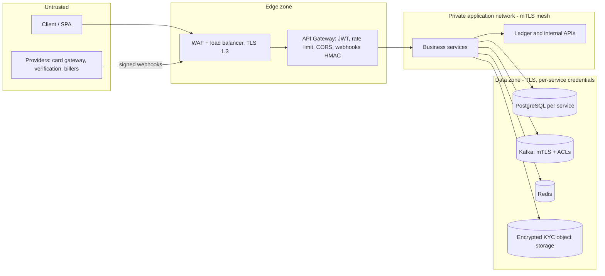

# Security, Compliance & Governance
**Banking Digital Wallet Platform — Security Architecture & Threat Model, Identity & Access Management, Key Management Policy, Data Protection, Compliance and Governance**

> **Scope note:** This document describes the **long-term target architecture**. The portfolio MVP deliberately deviates from it in places; every approved deviation is recorded in [`06. PortfolioMvpDecisions.md`](06.%20PortfolioMvpDecisions.md), which governs the MVP where the two conflict.

| Item | Value |
| ---- | ----- |
| Version | 1.1 — Final |
| Sources | `03`, `08`, `09`, `02` (security and compliance NFRs), `FInal/01` §8, `12/01`, plus decisions D-01…D-16 in `19` §0 |
| Labels | **[Source]** stated in the project documents · **[Added]** added by this set and approved by the owner (values accepted in D-08) · **[MVP-Ext]** applies to card linking, face verification and bill payment |

---

## 1. Security principles
1. **Defence in depth:** Gateway → authentication → role → permission → resource ownership → account/KYC status → business rules → audit.
2. **Least privilege:** administrators are not all-powerful; Super Admin cannot touch balances or transactions.
3. **Zero trust inside the network:** every service call uses mutual TLS and an allow-list (ADR-011).
4. **Financial integrity first:** immutable ledger, idempotency, optimistic locking, reconciliation, maker-checker.
5. **Auditability:** every financial and administrative action is traceable by `correlationId`.
6. **Data minimisation:** no card numbers, no biometric templates, no personal data in events.
7. **Secure by default:** TLS everywhere, secrets outside git, deny by default.

---

## 2. Security architecture

### 2.1 Trust zones


### 2.2 Control summary
| Concern | Control |
| ------- | ------- |
| Authentication | JWT access (15 min) + rotating refresh (7 days); BCrypt/Argon2 hashing; OTP; MFA [Backlog] |
| Gateway | JWT validation (ADR-008), rate limiting (Redis), CORS, security headers, correlation ID, webhook HMAC verification |
| Authorisation | RBAC + permissions + ownership; `@PreAuthorize` in every service |
| Service identity | mutual TLS, SPIFFE IDs, path allow-list per caller (ADR-011) |
| Encryption | TLS 1.3 at the edge, TLS 1.2+ with mTLS internally; AES-256 at rest; field-level encryption for KYC references and phone/email columns |
| Idempotency | `Idempotency-Key` on money POSTs; DB unique constraints as final guard |
| Sensitive operations | maker-checker via `approvals` |
| Audit | append-only `audit_logs` plus security events |
| Abuse controls | lock after 5 failed logins; session expiry 30 min inactivity; OTP 5 min, 5 attempts; face verification 3 attempts |
| Events | no secrets or personal data; HMAC-signed in staging and production |
| Ledger integrity | append-only ledger, role without UPDATE/DELETE, reconciliation, degraded mode |

---

## 3. Identity & Access Management (IAM)

### 3.1 Principals
| Principal | Identity store | JWT roles |
| --------- | -------------- | --------- |
| Customer | `identity_db.users` + `customer_db` | `CUSTOMER` |
| Merchant | same user, plus `payment_db.merchants` | `CUSTOMER`, `MERCHANT` |
| Staff | `identity_db.users` + `admin_db.admin_users` | `ADMIN` (plus permissions resolved from `admin_db`) |
| Services | X.509 certificates (SPIFFE IDs) | not JWT; identified by certificate |
| Jobs | service identity with `SYSTEM` permissions | — |

A user may hold several JWT roles; the `roles` claim is an array (D-14).

### 3.2 Staff roles (rows in `admin_db.roles`)
| Role | Purpose | Key permissions | Explicit denials |
| ---- | ------- | --------------- | ---------------- |
| ADMIN | Operations | `USER_READ/SEARCH/UPDATE/FREEZE/UNFREEZE`, `MERCHANT_*`, `TRANSACTION_READ/SEARCH`, `LIMIT_READ/UPDATE` (via approval), `REPORT_*`, `AUDIT_LOG_READ`, `BILLER_MANAGE` | delete transactions, change system config, manage admins |
| COMPLIANCE_OFFICER | KYC/AML | `KYC_READ/REVIEW/APPROVE/REJECT`, `KYC_FACE_REVIEW`, `AML_*`, `RISK_PROFILE_*`, compliance reports, `AUDIT_LOG_READ` | `TRANSFER_CREATE`, `PAYMENT_CREATE`, `WALLET_WITHDRAW`, `USER_DELETE`, `SYSTEM_CONFIG_UPDATE` |
| SUPPORT_AGENT | Support | `CUSTOMER_SEARCH`, `CUSTOMER_PROFILE_READ`, `TRANSACTION_READ`, `SUPPORT_CASE_*` | transfer, withdraw, approve KYC, change balance, delete transaction |
| FINANCE_OFFICER | Settlement/reconciliation | settlement, reconciliation, refund and adjustment approval | approving own requests |
| RISK_OFFICER | Fraud | `FRAUD_ALERT_READ/REVIEW/RESOLVE` | balance changes |
| AUDITOR | Read-only | `AUDIT_LOG_READ`, report read | every write |
| SUPER_ADMIN | Platform admin | `ADMIN_*`, `ROLE_*`, `PERMISSION_*`, `SYSTEM_CONFIG_*`, `SECURITY_POLICY_*` | **change wallet balances, delete or fabricate transactions** |
| OPERATIONS_MANAGER | Monitoring | dashboards, health, reconciliation read | financial writes |

Customer permissions: `CUSTOMER_PROFILE_READ/UPDATE`, `KYC_SUBMIT/READ`, `WALLET_READ/DEPOSIT/WITHDRAW`, `TRANSFER_CREATE/READ/CANCEL`, `PAYMENT_CREATE/READ`, `QR_SCAN`, `CARD_LINK/READ/REMOVE`, `BILL_PAYMENT_CREATE/READ`, `BENEFICIARY_CREATE/UPDATE/DELETE`, `TRANSACTION_READ`, `NOTIFICATION_READ/UPDATE`, `PASSWORD_CHANGE`.
Merchant permissions: `MERCHANT_PROFILE_READ/UPDATE`, `MERCHANT_QR_CREATE/READ/UPDATE`, `PAYMENT_READ`, `PAYMENT_REFUND_REQUEST`, `SETTLEMENT_READ`, `REPORT_READ`.
Naming rule (D-14): `RESOURCE_ACTION` with `READ` (not `VIEW`); legacy `*_VIEW` names in `03` are aliases.

### 3.3 Authorisation chain
```
Authenticate (valid JWT) → Role → Permission → Resource ownership
  → Account status + KYC level + wallet status → Business rules → ALLOW / DENY → Audit
```
- Ownership failures return 404 for resource ids, 403 for operations the caller can never perform.
- Money operations need: user `ACTIVE`, KYC approved with the level required for the amount/tier, wallet `ACTIVE`.
- Administrators cannot grant permissions beyond their own authority.
- Every authorisation failure is logged.

### 3.4 Authentication lifecycle
| Item | Rule |
| ---- | ---- |
| Registration | unique email and phone; `PENDING_VERIFICATION` until OTP verified |
| Password | strong policy; hashed (BCrypt/Argon2); no reuse; change revokes refresh tokens |
| Login | generic failure message; lock after 5 failures; inactive or frozen users blocked; every login audited |
| Access token | 15 minutes, asymmetric signature with `kid` |
| Refresh token | 7 days, rotated on every use, only the hash is stored, revoked on logout and password change; reuse of a rotated token revokes the whole session family |
| Session | expires after 30 minutes of inactivity |
| OTP | hashed, single-use, 5 minutes, 5 attempts, resend rate-limited |
| Step-up | transactions above the configured threshold require additional authentication (BR-009) |
| MFA | TOTP/OTP second factor [Backlog] |

**MVP values (doc 06 MVP-ADR-23):**
- Password:
  - 12–128 characters, counted in Unicode code points after NFC normalisation;
  - hashed with Argon2id, with configured cost (default memory 19 MiB, 2 iterations, parallelism 1);
  - may not repeat any of the last 5.

  Unknown and locked accounts run a dummy hash, so timing reveals nothing.
- Login: lock after 5 consecutive failures for 15 minutes, tracked per identifier, with the same `401` for a wrong password, an unknown account and a locked account. A password reset clears the lock, and the owner is emailed when it starts.
- OTP:
  - 6 digits, stored as a keyed hash; valid 5 minutes; 5 attempts per challenge;
  - resend cooldown 60 seconds, at most 5 resends per hour, and a resend cancels the previous code;
  - 5 used-up challenges in 24 hours block new challenges for that identifier until the window clears.

### 3.5 Maker-checker
`approvals(request_type, resource_type, resource_id, requested_by, approved_by, status, reason, expires)`.
Rules: requester ≠ approver; approver must hold the required role; rejection needs a reason; an approved action executes once; approvals expire (default 24 h); every step is audited. Required for: limit changes and tier upgrades to Premium, unfreeze of accounts frozen for fraud, merchant approval, refund approval above threshold, manual adjustments, system configuration changes, biller activation and suspension.

### 3.6 Service-to-service authorisation (ADR-011)
| Caller (SPIFFE ID) | Allowed internal paths |
| ------------------ | ---------------------- |
| `api-gateway` | all public service routes |
| `transfer-service` | `wallet/movements`, `wallet/compensations`, `wallet/by-customer`, `risk/evaluate` |
| `payment-merchant-service` | `wallet/movements`, `wallet/compensations`, `wallet/reservations*`, `wallet/by-customer`, `risk/evaluate` |
| `wallet-service` | `payment-merchant-service: cards/authorize` |
| `admin-operations-service` | `wallet/freeze|unfreeze|limits`, customer-kyc internal operations, `ledger` reads |
| `ledger-service` (consumer) | own `ledger/entries`; reads of source records for verification |
| Operations tooling | `ledger` reads and reversal, DLQ replay (break-glass, audited, approval required) |
Everything else is denied. Certificates are short-lived (§6); a revoked identity loses access at the next rotation or immediately through mesh policy.

---

## 4. Threat model

### 4.1 Assets
Customer funds (wallet snapshots and ledger), credentials and tokens, personal data and KYC documents including selfies, card tokens, audit logs, signing keys and certificates, event-stream integrity.

### 4.2 STRIDE analysis
| ID | Threat | Component | Cat. | Mitigation |
| -- | ------ | --------- | ---- | ---------- |
| T1 | Credential stuffing, brute force | Identity | S | rate limiting, lockout, generic errors, breached-password check, MFA [Backlog] |
| T2 | Forged or stolen JWT | Gateway | S | signature + `kid` validation, 15-min expiry, key rotation, refresh-token family revocation |
| T3 | IDOR on wallets, transfers, KYC, cards, bills | all | E/I | ownership checks everywhere, 404 for foreign ids, automated cross-customer tests |
| T4 | Privilege escalation through roles | Admin | E | only Super Admin assigns roles; no self-escalation; maker-checker; audit |
| T5 | Double spend or replay of money requests | Transfer, Wallet | T | idempotency keys, optimistic `version`, unique references, atomic movement |
| T6 | Lost update or race on balance | Wallet | T | optimistic locking, retry, DB CHECK ≥ 0, ordered locking |
| T7 | Tampering with ledger | Ledger | T | append-only, no UPDATE/DELETE grant, reversal only, periodic hash checksums, DB role separation |
| T8 | Forged Kafka event causing a fake ledger posting | Kafka | S/T | mTLS client certificates, producer-per-topic ACLs, HMAC-signed events, ledger verifies producer principal, validates and reconciles against source record |
| T9 | Lost or delayed ledger posting | Ledger consumer | R/D | outbox, DLQ, replay, `ledgerStatus`, lag alerts, reconciliation, degraded mode |
| T10 | Duplicate event processing | consumers | T | `processed_events` + unique `transaction_reference` |
| T11 | Internal API exposed publicly | Gateway | I/E | no `/internal/**` route, network policy, mTLS, automated exposure test |
| T12 | Personal data leaking through events or logs | Kafka, logs | I | IDs only in events, log masking, payload schema lint |
| T13 | Injection, XSS, CSRF | APIs, SPA | T/E | parameterised queries, validation, output encoding, bearer-token auth, CSP |
| T14 | KYC documents or selfies exposed | storage | I | encrypted bucket, per-object keys, pre-signed URLs ≤ 5 min, access limited to compliance roles, access audited, malware scan on upload |
| T15 | Biometric misuse | face verification | I/E | explicit consent, no templates stored, results and provider reference only, retention limit, provider contract (no secondary use) |
| T16 | Spoofed face verification (deepfake, photo) | KYC | S | provider liveness, 3-attempt cap, manual review band, compliance approval always required |
| T17 | Card data theft | cards | I | hosted fields (PAN never touches platform), token only, no logging of card payloads, CSP on checkout |
| T18 | Forged payment or KYC webhook | Gateway | S/T | HMAC signature, timestamp tolerance, `providerEventId` replay protection, IP allow-list |
| T19 | Card testing / fraud via linked cards | cards | S | rate limits, risk evaluation on card deposits, velocity rules, card status BLOCKED |
| T20 | Biller fraud or wrong-account payment | bills | T | inquiry before pay, masked account name displayed, reservation-based capture, provider reference stored, reconciliation |
| T21 | Insider abuse | Admin | R/E | maker-checker, immutable audit, no balance-change rights, auditor role, break-glass logging |
| T22 | Denial of service | Gateway | D | rate limits, WAF, circuit breakers, bulkheads, autoscaling |
| T23 | OTP interception or abuse | Identity | S | hashed OTP, short expiry, attempts cap, SMS provider hardening |
| T24 | Secrets in repository or CI | Git | I | secret scanning, `.gitignore`, secret manager, no secrets in images |
| T25 | Vulnerable dependencies or images | build | T | dependency and image scanning, pinned versions, SBOM |
| T26 | Rogue internal service | mesh | E | mTLS identity, path allow-list, short-lived certificates |

### 4.3 Fraud scenarios and controls
Velocity transfers, new device with high value, structuring below limits, mule accounts, card testing, merchant collusion. Controls: risk rules (for example `amount > 50,000 AND new_device → HIGH`), tiered limits, fraud alerts with review/resolve, blocked transactions never touch balances.

**MVP (doc 06 MVP-ADR-24):**
- Risk score 0–100 from configured rules: amount, transfer frequency within 10 minutes, new recipient, new sender wallet (weights in doc 06 MVP-ADR-24). A failed evaluation rejects the transfer (fail closed), never score 0. The four bands:
  - 0–39: allow;
  - 40–69: allow and monitor;
  - 70–89: hold for manual review by a `COMPLIANCE_OFFICER`, never the sender or the recipient, with the amount reserved and no funds moved;
  - 90–100: block and open an investigation.
- Scores, triggered rules, decisions and review history are recorded (Internal data, staff-only) and audited.
- Recipient lookup by exact wallet number is rate-limited (10/min per user, 30/min per IP, stored in PostgreSQL) and audited, against enumeration (doc 06 MVP-ADR-20).
- A held transfer expires after 24 hours; compliance officers are warned after 12 hours.


### 4.4 Residual risks
A seconds-long window between wallet and ledger (accepted; reconciliation and degraded mode). Dependence on third-party providers for OTP delivery, card authorisation, biller access and face verification (mitigated by timeouts, circuit breakers, stubs for failover testing, and status-query recovery).

---

## 5. Data protection

### 5.1 Classification
| Class | Examples | Handling |
| ----- | -------- | -------- |
| Restricted | password hashes, tokens, keys, KYC files, selfies, verification scores, card tokens | encrypted at rest, field/object encryption, minimal access, never in logs or events |
| Confidential | balances, transactions, email, phone, date of birth, bill account references | encrypted, role-based access, masked in UI and logs |
| Internal | audit logs, configuration | access controlled |
| Public | API documentation | — |

### 5.2 Rules
- Mask sensitive fields in responses and support tools (BR §2, PROFILE-01, TXN-04); bill account references are masked except the last 4 characters in lists.
- Financial data is never silently deleted; corrections use reversal.
- **Cards:** PAN, CVV and expiry are never received, stored or logged; only the gateway token, brand, last four digits and expiry month/year are kept. Target PCI scope is SAQ A (hosted fields). Card removal deletes the token at the gateway.
- **Biometrics and KYC files:** consent captured before capture; selfies and documents stored in an encrypted bucket with per-object keys; face templates are never stored; verification score is staff-only; files follow the KYC retention rule (§8) and are deleted when it expires.
- Database credentials are per service; no service reads another service's database.
- Data residency: primary region in Thailand (`ap-southeast-7`); the disaster-recovery region holds encrypted replicas under the same contractual controls.

---

## 6. Key Management Policy

### 6.1 Inventory and rotation (D-08)
| Key / secret | Purpose | Storage | Rotation | Owner |
| ------------ | ------- | ------- | -------- | ----- |
| JWT signing key pair | sign and verify access tokens | KMS-backed; Gateway reads public keys through a JWKS endpoint | **90 days** with `kid` overlap; immediate on compromise | Security |
| Refresh-token hashing pepper | store `token_hash` | secret manager | 12 months (dual-verify) | Security |
| OTP hashing secret | store `otp_hash` | secret manager | 12 months | Security |
| Data-encryption keys (DEK) | field and object encryption (KYC references, selfies, PII columns) | envelope-encrypted by KMS KEK | per table/bucket prefix, annual re-wrap; per-object keys for KYC files | Security / DBA |
| Key-encryption keys (KEK) | wrap DEKs | AWS KMS customer-managed keys | automatic annual | Security |
| Internal CA and service certificates | mutual TLS | mesh CA backed by KMS/HSM root | leaf ≤ 24 h automatic; intermediate yearly; root offline, 5 years | DevOps / Security |
| Edge TLS certificates | public HTTPS | ACM | automatic; alert at 14 days | DevOps |
| Kafka, DB, Redis credentials | access | secret manager / sealed secrets | **90 days**, per service | DevOps |
| Event HMAC keys | sign events (staging, production) | secret manager per producer | **90 days** | Security |
| Webhook secrets | verify provider callbacks | secret manager per provider | **90 days**, overlap window with provider | Security |
| Backup encryption keys | encrypted backups | KMS | annual | DBA |

### 6.2 Principles
No keys in git, images or logs. Separation of duties: no individual can use the KEK and read database snapshots. Every key use is logged (KMS audit trail). Development and test keys are never used in production. Keys are generated inside KMS/HSM where possible.

### 6.3 Compromise procedure
Revoke → rotate (new `kid`/secret) → invalidate affected tokens and sessions → review audit logs → notify Compliance and, where required, the regulator → post-incident review within 5 business days.

---

## 7. Audit, logging and security monitoring

### 7.1 Auditable events [Source BR §22]
Login/logout, password changes, KYC decisions and **face-verification results and overrides**, wallet and customer freeze/unfreeze, status changes, transfers, payments, refunds, **card link/remove**, **bill payments**, admin actions, permission changes, configuration changes, fraud decisions, financial adjustments, authorisation failures, access to KYC files.

### 7.2 Audit record
`actor, action, resource, resourceId, timestamp, result, IP, device, correlationId, oldValue, newValue`. Append-only; auditor read-only; retained 7 years.

### 7.3 Security signals
Failed-login spikes, lockouts, refresh-token reuse, 403 and 404 spikes, privilege changes, webhook signature failures, certificate failures, blocked transactions, DLQ growth, ledger posting failures, reconciliation exceptions → alert routes in `22` §7.

---

## 8. Compliance and regulatory governance

| Domain | Requirement | Implementation |
| ------ | ----------- | -------------- |
| KYC | mandatory before restricted operations; only authorised compliance staff approve/reject; rejection needs reason; one active application | KYC states, wallet creation only after approval, role checks, audit |
| Face verification | identity assurance | provider liveness and match, manual-review band, compliance sign-off, consent record |
| AML | monitor suspicious activity | risk rules, fraud alerts, compliance roles; case management [Backlog]; sanctions screening [Backlog] |
| PCI DSS | listed in BRD | SAQ A scope through hosted fields and tokens; annual attestation; quarterly vulnerability scans for the checkout page |
| Privacy (GDPR / local law) | lawful basis, consent, minimisation, rights | consent for biometrics, data subject request process, masking, access logging, retention schedule |
| Financial records | immutable and auditable | ledger design (`19` §6) |
| Periodic review | security and compliance audits | quarterly access review, annual penetration test, annual DR test, annual policy review |

**Retention schedule (D-08):**
| Data | Retention |
| ---- | --------- |
| Financial transactions, ledger, approvals, audit logs | 7 years |
| KYC records and documents | 7 years after the relationship ends, then deleted |
| Selfies and face-verification results | with the KYC record; face templates not stored |
| Application logs | 30 days searchable, 1 year archived |
| OTP, idempotency keys, sessions | per expiry (≤ 30 days) |

---

## 9. Governance

### 9.1 Responsibilities
| Activity | Security | Compliance | Architect | DevOps | Product |
| -------- | :-: | :-: | :-: | :-: | :-: |
| Threat model upkeep | A/R | C | R | C | I |
| Key rotation | A | I | C | R | I |
| Access reviews | A | R | I | R | I |
| KYC/AML and biometrics policy | C | A/R | I | I | C |
| Provider due diligence (card, KYC, biller) | R | R | C | C | A |
| Release approval | C | C | R | R | A |
| Incident response | A | R | C | R | I |

### 9.2 Secure SDLC
Conventional Commits, PR required, branch protection, squash merge. CI gates: build, unit, integration (Testcontainers), lint, **SAST, dependency, image and secret scanning**. Security test suite: 401/403, cross-customer access for every resource type, idempotency replay, concurrent withdrawals, ledger balance invariant, internal-path exposure, webhook signature rejection, mTLS denial of unauthorised callers, KYC file access control. Flyway migrations are append-only. No secrets in git.

### 9.3 Change management
Sensitive configuration (limits, fraud thresholds, face-verification thresholds, feature flags, degraded-mode threshold) changes go through maker-checker and are audited. Architecture changes require an ADR.

### 9.4 Incident response
Detect → triage (P1–P4) → contain (freeze wallets, disable keys or providers, enable degraded mode) → eradicate → recover → post-mortem within 5 business days. Financial incidents require wallet-versus-ledger reconciliation before services reopen. Provider breaches trigger the provider's contractual notification, and Compliance determines regulatory notices.

### 9.5 Control matrix
| Control | Requirement | Verified by |
| ------- | ----------- | ----------- |
| Role + ownership | BR §21, RBAC-05 | cross-customer integration tests |
| Idempotency | BR §25, TRANS-01 | replay tests |
| Immutable ledger | BR §16 | DB grants test + invariant test |
| Ledger/wallet agreement | ADR-010 | reconciliation job, alert on exception |
| Maker-checker | BR §20 | approval workflow tests |
| Internal API isolation | Final §4 | Gateway exposure test; mTLS tests |
| Audit completeness | BR §22 | audit assertion per sensitive endpoint |
| No personal data or secrets in events | Final §7 | payload schema lint |
| Card data never stored | PCI | log and database scans in CI |
| Biometric consent | privacy | API test `CONSENT_REQUIRED` |
