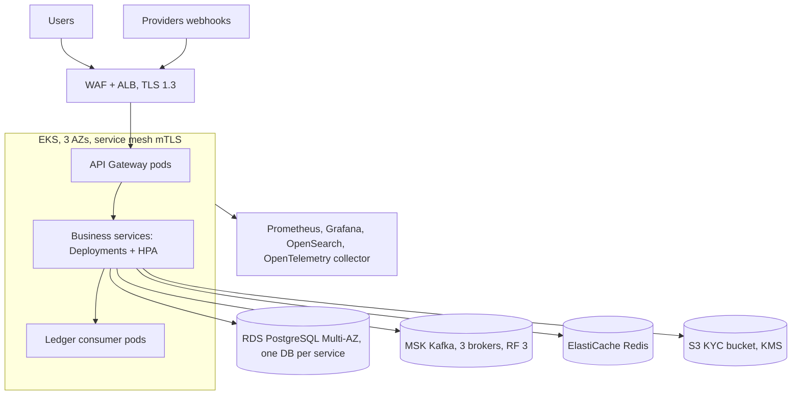

# Operations & DevOps Documentation
**Banking Digital Wallet Platform — Deployment & Infrastructure, CI/CD, Observability, Alerting, Runbooks, Backup & Disaster Recovery**

| Item | Value |
| ---- | ----- |
| Version | 1.1 — Final |
| Sources | `12/01`–`12/03`, `13`, `15`, `18`, BRD/Vision NFRs, `19`–`21`, decisions D-01…D-16 |
| Labels | **[Source]** from project documents · **[Added]** added by this set and approved (D-08 values) · **[MVP-Ext]** card linking, face verification, bill payment |
| Note | The repository is documentation-only until Sprint 0 executes; this is the target operating model. |

---

## 1. Operating targets

| Metric | Target |
| ------ | ------ |
| Availability | 99.99%; no single point of failure; automatic failover; multi-AZ [Source] |
| API latency | p95 < 200 ms; login < 2 s; payment < 3 s; balance < 1 s; dashboard < 3 s [Source] |
| Throughput | 5,000 TPS platform target; 1M users [Source] |
| Payment success / failure | > 99.9% / < 0.1% [Source] |
| Reliability | retries, circuit breakers, idempotent APIs, DLQ, rollback [Source] |
| Ledger posting lag | p95 < 5 s, p99 < 30 s, zero lost events |
| Bill payment success (excluding provider-declined) | > 99.5%; no unresolved `PENDING` older than 15 min |
| Face verification turnaround | provider result < 30 s p95 |
| RPO / RTO | **RPO 5 min, RTO 1 h** for Tier 1 (D-08) |

Service tiers: **Tier 1** Gateway, Identity, Wallet, Transfer, Payment & Merchant, Ledger, Kafka, PostgreSQL. **Tier 2** Customer & KYC, Risk & Notification. **Tier 3** Admin & Operations, reporting.

---

## 2. Environments

| Environment | Purpose | Infrastructure |
| ----------- | ------- | -------------- |
| local | developer demo | Docker Compose: Gateway, services, PostgreSQL (database per service), Redis, Kafka, Config Server, Eureka, dev PKI, provider stubs, Prometheus, Grafana |
| ci | build and test | GitHub Actions + Testcontainers |
| staging | production-like, load tests | Kubernetes with service mesh, scaled down, provider sandboxes |
| production | live | AWS Thailand region (`ap-southeast-7`): EKS, RDS PostgreSQL Multi-AZ, MSK, ElastiCache, ALB + WAF, S3, KMS; DR in `ap-southeast-1` |

Local entry point `http://localhost:8080`; SPA `http://localhost:5173` with Gateway CORS.

---

## 3. Deployment and infrastructure

### 3.1 Local Compose topology (D-10)
```
api-gateway :8080 → identity, customer-kyc, wallet, transfer, payment-merchant,
                    risk-notification, admin-operations
internal only: ledger-service (consumer + internal API), risk evaluate API
infra: postgres (9 databases), redis, kafka, config-server, discovery-server (Eureka),
       pki (dev CA, 30-day certificates, mTLS enabled), stubs (card gateway, verification,
       biller aggregator, SMS/email), prometheus, grafana, elasticsearch/opensearch (optional profile)
```
Databases: `identity_db`, `customer_db`, `wallet_db`, `transfer_db`, `payment_db`, `ledger_db`, `risk_db`, `notification_db`, `admin_db`.
Boot order: infra and PKI → Identity + Gateway → Customer & KYC → Wallet + Ledger (Kafka first) → Transfer → Payment & Merchant → rest. A thin Gateway may proxy only running services.

### 3.2 Production topology


### 3.3 Kubernetes standards
| Item | Standard |
| ---- | -------- |
| Packaging | Helm chart per service; one image per service |
| Replicas | Tier 1 ≥ 3 across AZs; Tier 2 ≥ 2; Tier 3 ≥ 2 |
| Probes | `/actuator/health/liveness` and `/readiness`; readiness checks DB and, for consumers, Kafka |
| Resources | requests and limits set; JVM `-XX:MaxRAMPercentage=75` |
| Autoscaling | HPA on CPU and custom metrics (RPS; consumer lag for Ledger and Notification) |
| Resilience | PodDisruptionBudgets, anti-affinity across AZs, graceful shutdown (drain consumers, flush outbox) |
| Network | NetworkPolicies: only Gateway reachable from ingress; databases only from the owning service |
| mTLS | mesh sidecars issue SPIFFE certificates (≤ 24 h) and enforce `AuthorizationPolicy` per caller and path (`21` §3.6) |
| Config and secrets | ConfigMaps plus External Secrets/sealed secrets; no Config Server or Eureka in production |
| Discovery | Kubernetes DNS |

### 3.4 Data infrastructure
- **PostgreSQL:** database per service; separate instances for Wallet and Ledger (Tier 1) with distinct credentials; PITR enabled; the Ledger application role has `INSERT` and `SELECT` only on `ledger_entries` and `financial_transactions`.
- **Kafka (MSK):** RF 3, `min.insync.replicas=2`, producers `acks=all` and idempotent, TLS client certificates, per-topic ACLs. Partitions: wallet, transfer, payment 12; others 3. Retention: events 7 days; DLQ 30 days.
- **Redis:** idempotency keys, rate-limit counters, OTP, optional balance cache, degraded-mode flag; replicated; not a source of truth.
- **S3 (KYC):** private bucket, SSE-KMS with per-object keys, versioning on, lifecycle deletion per retention, pre-signed URL ≤ 5 min, access logging enabled.
- **Outbox publishers:** `SELECT … FOR UPDATE SKIP LOCKED`, multiple instances safe.

### 3.5 Scalability notes
Gateway and Payment & Merchant scale first. Ledger consumers scale up to the partition count. Wallet write contention is limited to per-wallet optimistic locking; merchant hot wallets use batched settlement in the Backlog.

---

## 4. CI/CD

### 4.1 Pipeline [Source: GitStrategy, OPS-05]
```
PR to main → build → unit → integration (Testcontainers) → lint/format
          → SAST, dependency, image and secret scan
          → squash merge → build image → push registry
          → deploy staging → smoke + contract tests → manual gate → deploy production (canary)
```
- Trunk-based; branches `feature/*`, `fix/*`, `chore/*`, `refactor/*`, `spike/*`, `hotfix/*`; Conventional Commits with commitlint; Spotless/Checkstyle pre-commit.
- Branch protection on `main`: PR required, checks required, up to date, squash only.
- Per-module pipelines with path filters.
- Flyway: append-only after merge, one stream per database; run as an init Job in production; expand → migrate → contract for zero-downtime changes.
- Tags: `v0.1.0` Identity + Gateway · `v0.2.0` Customer & KYC (with face verification) · `v0.3.0` Wallet + Ledger · `v0.4.0` Transfer + reconciliation · `v0.5.0` Payment/QR + cards · `v1.0.0` Admin/risk + deployed demo · `v1.1.0` bill payment and top-up. Hotfix: branch from the deployed tag, PR to `main`, patch tag.

### 4.2 Quality gates
| Gate | Rule |
| ---- | ---- |
| Unit | domain logic: money, limits, tiers, transfer rules, reservations |
| Integration | auth flow; KYC approval → wallet creation; wallet concurrency; idempotency; outbox → Kafka → Ledger consumer; reconciliation; card webhook; bill payment timeout and recovery |
| Contract | OpenAPI conformance; Pact for Transfer ↔ Wallet and Payment ↔ Wallet |
| Security | cross-customer access; internal path exposure; mTLS rejection; webhook signature rejection |
| Performance | k6 transfer test in staging; results saved under `docs/` |
| Coverage | ≥ 80% on domain and application layers |

### 4.3 Release strategy
Rolling updates for stateless services; **canary 5% → 25% → 100%** for Wallet, Transfer, Payment & Merchant and Ledger, with automatic rollback on error-rate or latency breach. Feature flags for card linking, face verification and bill payment per provider. Ledger consumers stay backward compatible with older `eventVersion`s. Money-path deployments avoid peak hours (Thailand time).

---

## 5. Configuration management
| Category | Examples | Control |
| -------- | -------- | ------- |
| Static | DB URLs, brokers, Redis, JWKS | ConfigMap / Config Server (local) |
| Business | `TRANSFER_DAILY_LIMIT` tiers (100,000 / 500,000 / 1,000,000), `MAX_WITHDRAWAL_AMOUNT=50000`, `MAX_LOGIN_ATTEMPTS=5`, `OTP_EXPIRATION_SECONDS=300`, `LEDGER_DEGRADED_THRESHOLD_SECONDS=300`, `LEDGER_DEGRADED_MAX_AMOUNT=50000`, face thresholds 0.85/0.60, reservation TTL 15 min | Admin config API [Backlog]; until then ConfigMap changes via reviewed PR; production changes through maker-checker; audited |
| Feature flags | `cards.enabled`, `faceVerification.enabled`, `billPayment.enabled`, per-biller flags | same |
| Secrets | credentials, signing keys, webhook secrets | secret manager |

---

## 6. Observability

### 6.1 Logging
SLF4J + Logback structured JSON to ELK/OpenSearch (D-11). Mandatory fields: `timestamp, level, service, correlationId, traceId, userId (id only), eventId, path, status`. Never log passwords, tokens, OTPs, card data, KYC content or scores. Retention: 30 days searchable, 1 year archived.

### 6.2 Metrics (Micrometer → Prometheus → Grafana)
| Area | Metrics |
| ---- | ------- |
| HTTP | rate, errors, p50/p95/p99 per endpoint |
| Gateway | 401/403/429 counts, webhook signature failures |
| Identity | logins, failures, locks, OTP sent/verified |
| KYC | applications by status, face verification results by `PASS/MANUAL_REVIEW/FAIL`, provider latency, review queue age |
| Wallet | deposits, withdrawals, **version conflicts and retries**, reservations held/captured/released/expired, wallet creation latency after `KycApproved` |
| Transfer, Payment | counts by status, idempotent replays, risk decisions, compensations, degraded-mode rejections |
| Cards | links, removals, authorisations, declines, webhook delays |
| Bills | payments by status and biller, provider latency, `PENDING` age, provider error rate |
| Outbox | unpublished count, oldest age, publish failures |
| Kafka | consumer lag per group, DLQ count, produce errors |
| Ledger | posting latency, **ledger lag** (age of oldest unposted event), duplicate hits, unbalanced rejections (must be 0), `FAILED_POST` count |
| Reconciliation | open exceptions, last run duration and status |
| Notification | sent, failed, retried |
| mesh/mTLS | certificate expiry, handshake failures, denied calls |
| JVM / DB | heap, GC, threads, Hikari pool, slow queries |
| Business | TPS, volume per day, registrations, KYC pending, fraud alerts open |

### 6.3 Tracing
Micrometer Tracing / OpenTelemetry across REST and Kafka (`traceparent` and `correlationId` in message headers). A transfer trace shows Gateway → Transfer → Risk → Wallet → (async) Ledger → Notification.

### 6.4 Dashboards
1. Platform overview (golden signals) 2. Money flow 3. **Ledger and reconciliation** 4. Kafka and outbox 5. Security (auth failures, 403s, webhook failures, mTLS denials) 6. KYC and verification 7. Cards and bills (providers) 8. Infrastructure.

### 6.5 Health checks (OPS-01)
Each service exposes Actuator liveness and readiness including DB (and Kafka for consumers). Demo check: `GET http://localhost:8080/actuator/health` returns `UP`.

---

## 7. Alerting

Severity: **P1** page immediately · **P2** page on-call within 30 min · **P3** ticket.

| Alert | Condition | Sev |
| ----- | --------- | --- |
| Tier 1 service down | readiness failing > 1 min | P1 |
| High 5xx on money endpoints | > 2% for 5 min | P1 |
| Latency breach | p95 > 500 ms for 10 min | P2 |
| **Ledger lag** | oldest unposted event > 5 min (also enables degraded mode) | P1 |
| **Unbalanced posting** | any | P1 |
| `FAILED_POST` | any | P1 |
| Kafka consumer lag (ledger group) | growing for 10 min | P1 |
| DLQ | any ledger-topic message; > 100 on others | P1 / P2 |
| Outbox backlog | oldest unpublished > 2 min | P1 |
| Reconciliation exception | any wallet-vs-ledger mismatch | P1 |
| Stuck `PROCESSING` transfers | any older than 2 min after recovery job | P2 |
| Bill payment `PENDING` | older than 15 min | P2 |
| Reservation leakage | held reservations past TTL > 0 | P2 |
| Wallet version conflicts | retry rate > 5% | P2 |
| Wallet not created | approved KYC without wallet after 2 min | P2 |
| Card or bill provider errors | error rate > 10% for 5 min (feature flag switch available) | P2 |
| Face verification provider | failure rate > 20% for 10 min | P2 |
| Webhook signature failures | > 5 in 5 min | P2 |
| Login anomaly | failed logins > 10× baseline | P2 |
| Fraud blocks | > 3× baseline | P2 |
| mTLS | certificate expiry < 6 h without renewal; handshake failures spike | P1 / P2 |
| DB | connections > 80%, replication lag > 30 s, disk > 80% | P2 |
| Redis | evictions > 0, memory > 80% | P2 |
| Backup failure | any | P2 |
| Edge certificate | expiry < 14 days | P3 |

Routing: on-call platform (P1/P2), chat channel (P3). Every alert links to a runbook.

---

## 8. Runbooks

**RB-1 Ledger lag or consumer stuck.** Check consumer lag and logs; confirm Kafka and `ledger_db`; find a repeating failure (poison event) → DLQ; fix the cause (for example missing ledger account → replay `WalletCreated` or rely on lazy creation); replay from DLQ (idempotent on `transaction_reference`); run reconciliation for the window; confirm `ledgerStatus` clears. Degraded mode enables automatically at 5 min; disable manually only after lag < 1 min.

**RB-2 Outbox backlog.** Check publisher instances and Kafka availability; restart publishers; consumers are idempotent so duplicate delivery is safe.

**RB-3 Wallet vs ledger mismatch.** Freeze affected wallets if material; compare source records with ledger transactions; post the missing entries with the internal ledger API or reverse duplicates; never edit ledger rows or force wallet balances; adjustments go through maker-checker; document the incident.

**RB-4 Kafka broker or partition issue.** Check ISR; shift leaders; if the cluster is read-only, outbox tables buffer events so the money path keeps working; degraded mode may engage.

**RB-5 Database failover.** Confirm RDS failover; services reconnect; check Flyway state; run RB-6.

**RB-6 Stuck `PROCESSING` transfers or payments.** Recovery job (every minute) selects items older than 2 min: if both wallet legs exist → mark `COMPLETED` and publish event; if only a debit exists → compensate and mark `FAILED`; if neither → `FAILED`.

**RB-7 Security incident.** Rotate the JWT key (`kid`), revoke refresh tokens, force re-login, review audit logs, notify Compliance (`21` §9.4).

**RB-8 DLQ replay.** List DLQ → classify (schema, poison, transient) → fix → replay with the original `eventId` → confirm de-duplication and posting.

**RB-9 Wallet missing after KYC approval.** Check `customer.events` for `KycApproved`, Wallet consumer lag and `processed_events`; replay the event (idempotent on customer id); verify `WalletCreated` reached Ledger.

**RB-10 Bill payment stuck `PENDING`.** Query the provider with our `reference`; if `SUCCESS` capture the reservation and mark `SUCCESS`; if `FAILED` release and mark `FAILED`; if unknown after the retry window, keep reserved, open a ticket with the provider; reservations never exceed TTL without a decision (expiry releases funds only after provider confirms non-payment).

**RB-11 Card gateway or webhook problems.** Verify webhook signatures and secret rotation; reprocess `PENDING` deposits by querying the gateway; switch `cards.enabled` off to stop new card deposits if the gateway is degraded.

**RB-12 Face verification provider outage.** Switch to manual-review queue (feature flag `faceVerification.mode=MANUAL`); compliance reviews documents and selfies; no verification is auto-passed during an outage.

**RB-13 Certificate or mTLS failure.** Check mesh CA health and certificate expiry; restart affected sidecars; if the CA is down, existing certificates last ≤ 24 h — escalate P1 before expiry; never disable mTLS in production.

---

## 9. Backup, disaster recovery and continuity

| Item | Policy |
| ---- | ------ |
| PostgreSQL | PITR with 5-minute RPO; daily snapshots kept 35 days; cross-region encrypted copy to `ap-southeast-1`; **Wallet and Ledger restored to the same timestamp**; Ledger is authoritative if they diverge, then reconciliation runs |
| Kafka | RF 3 across AZs; topic replication to DR; outbox tables are the recovery source for unpublished events |
| S3 KYC bucket | versioning, cross-region replication, KMS multi-region key |
| Redis | rebuildable; idempotency TTL loss tolerated because DB unique constraints remain |
| Configuration and secrets | versioned in git/secret manager, replicated |
| Drills | semi-annual restore test; annual region failover test |
| Recovery order | PostgreSQL → Kafka → mesh/CA → Identity and Gateway → Wallet and Ledger → Transfer and Payment → others → reconciliation → enable money movement |
| RTO | 1 hour for Tier 1 |

---

## 10. Capacity and performance
- Platform target 5,000 TPS; each service budgeted against the 200 ms p95 API target.
- k6 scenarios: login, balance read, deposit, transfer (hot sender and many senders), QR confirm, card deposit with webhook, bill payment, ledger backlog drain.
- Sprint 6 acceptance: sustained target load with error rate < 0.1%, ledger lag p99 < 30 s, no negative balances, every ledger transaction balanced, reconciliation clean, no leaked reservations.
- Tuning knobs: Hikari pools, Kafka partitions and consumer concurrency, balance cache, indexes on `transfers.created_at`, `ledger_entries`, `bill_payments`.

---

## 11. On-call and operational process
- On-call rotation for Tier 1; escalation to engineering lead and Compliance for financial or security incidents.
- Post-incident review within 5 business days; action items tracked.
- Weekly operations review: SLO burn, DLQ, reconciliation, provider health, security alerts, KYC queue age.
- Production access through SSO with MFA, time-bound and audited; no direct database writes — only approved scripts under maker-checker.
- Provider operations: sandbox keys separate from production; webhook secrets rotated every 90 days; provider status pages monitored.

---

## 12. Operations work by sprint
| Sprint | Operational deliverable |
| ------ | ----------------------- |
| 0 | Compose, **dev PKI and mTLS**, CI skeleton, JSON logs, correlation ID, provider stubs |
| 1 | auth rate limiting, health checks |
| 2 | KYC file storage, webhook endpoint with HMAC, face-verification provider adapter and stub |
| 3 | Wallet-on-`KycApproved` consumer, Kafka topics and ACLs, outbox publisher, **Ledger consumer, DLQ, `ledgerStatus` updates** |
| 4 | **reconciliation job**, recovery job, lag metrics and alerts, degraded mode |
| 5 | Micrometer + Prometheus + Grafana in Compose, hot-table indexes, card gateway adapter and webhook |
| 6 | Kubernetes/Helm, mesh policies, deploy pipeline, k6 results, alerting, README as built |
| 7 | biller adapter, bill reservation recovery job, biller dashboards, provider feature flags |
