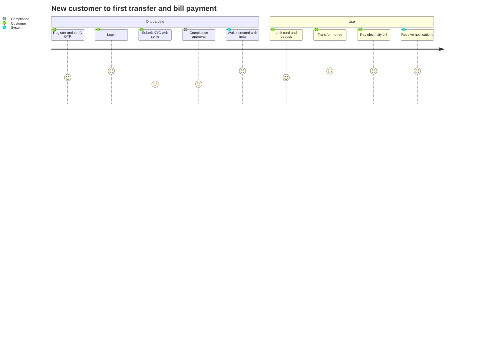

# Product & Business Documentation
**Banking Digital Wallet Platform — Product Requirements (PRD), Business Rules, User Manuals, Back-Office Guide, Roadmap, Traceability**

> **Scope note:** This document describes the **long-term target architecture**. The portfolio MVP deliberately deviates from it in places; every approved deviation is recorded in [`06. PortfolioMvpDecisions.md`](06.%20PortfolioMvpDecisions.md), which governs the MVP where the two conflict.

| Item | Value |
| ---- | ----- |
| Version | 1.1 — Final |
| Sources | `01`–`10`, `13`, `17`, `18`, `19`–`22`, decisions D-01…D-16 |
| Labels | **[MVP]** first demo (Sprints 0–6) · **[MVP-Ext]** approved extension: face verification (Sprint 2), card linking (Sprint 5), bill payment and top-up (Sprint 7) · **[Backlog]** later · **[Future]** v2/v3 |
| UI note | Screens described here are the React demo SPA (`17`), a thin client of the Gateway API. Back-office screens are operator screens of that same SPA. |

---

## 1. Product overview

### 1.1 Vision
A secure, scalable, enterprise-grade digital wallet where customers hold, send, receive and pay money digitally, with strong compliance, fraud control and auditability, designed so future banking products (loans, savings, insurance, investment) can be added without changing the core architecture.

### 1.2 Business goals
1. Reduce cash dependency through digital payments.
2. Send and receive money instantly.
3. Provide secure online payments, including bills and mobile top-up.
4. Extend to future banking products on the same core.

### 1.3 Success metrics
| KPI | Target |
| --- | ------ |
| Registration success rate | > 98% |
| Payment success rate | > 99.9% |
| API response time | < 200 ms |
| Availability | 99.99% |
| Failed transaction rate | < 0.1% |
| Monthly active users | 500,000+ |
| Fraud detection accuracy | > 95% |
| KYC review turnaround | < 1 business day |
| Face-verification first-attempt pass rate | > 85% |
| Ledger posting lag p99 | < 30 s |
| Support first response | < 4 hours |

### 1.4 Personas
| Persona | Needs | Pain points |
| ------- | ----- | ----------- |
| Busy office worker (customer) | quick transfer, QR payment, bill payment, top-up | queues, slow transfers |
| Small shop owner (merchant) | QR payments, daily sales report, refunds | cash handling, manual bookkeeping |
| Bank operations officer | KYC verification, fraud monitoring, customer management | manual approvals, complex workflows |

### 1.5 Roles
Customer, Merchant, Admin, Compliance Officer, Support Agent, Finance Officer, Risk Officer, Auditor, Super Admin, Operations Manager, System (`21` §3).

---

## 2. Scope

### 2.1 In the first demo [MVP] (Sprints 0–6)
Registration and OTP; login, logout, refresh, password change and reset; customer profile; KYC with document upload, submission, review, approval and rejection; **wallet created after KYC approval**; balance, limits, status, deposit, withdrawal, freeze; P2P transfer with beneficiaries and idempotency; merchant registration, QR scan and confirm, payments and refunds endpoints; notifications (email stub) and preferences; fraud risk evaluation and alerts; admin dashboard, customer freeze/unfreeze/suspend, transactions view, approvals (maker-checker), RBAC, audit logs; ledger reconciliation; observability; CI/CD and a deployed demo.

### 2.2 Approved extensions [MVP-Ext]
| Feature | Delivered in | Summary |
| ------- | ------------ | ------- |
| Face verification | Sprint 2 (inside KYC) | selfie and liveness through a provider; score thresholds; manual-review band; compliance still approves |
| Card linking | Sprint 5 | link a debit or credit card (token only), list, remove; fund the wallet by card |
| Bill payment and mobile top-up | Sprint 7 (`v1.1.0`) | billers by category, inquiry, payment with reservation, history, failure handling |

### 2.3 Backlog (after the MVP and extensions)
MFA, device management, security activity, bank transfer, transaction search/filter/statements, full refund workflow screens, customer support cases, platform and merchant reports, SMS and push notifications, settlement and reconciliation back-office, scheduled transfers, risk-based limits, tracing, compliance reports, sanctions screening.

### 2.4 Future
v2: international remittance, multi-currency, FX, savings, fixed deposits, loans, credit scoring, investments, Open Banking, Apple/Google Pay, wearables. v3: AI assistant, budgeting, predictive fraud, crypto, BNPL, cross-border QR, voice payments, spend analytics. Virtual cards are not planned.

---

## 3. Product requirements

### 3.1 Epics
| Epic | Stories | Service | Status |
| ---- | ------- | ------- | ------ |
| 1 Authentication & Security | AUTH-01…07; AUTH-08 MFA | Identity | MVP; MFA Backlog |
| 2 Customer Profile | PROFILE-01, 02; 03–05 | Customer & KYC | MVP; rest Backlog |
| 3 KYC & Identity | KYC-01…06 incl. document upload (KYC-02) and **face verification** | Customer & KYC, Admin | MVP / MVP-Ext |
| 4 Wallet | WALLET-01…08 | Wallet | MVP (WALLET-01 triggered by KYC approval) |
| 5 Money Transfer | TRANS-01, 02, 04, 05, 06, 09, 10; TRANS-03, 07, 08 | Transfer | MVP; bank and scheduled Backlog |
| 6 Transactions | TXN-01…06 | Wallet, Transfer, Payment | per-service lists MVP; unified API Backlog |
| 7 QR Payment | QR-01…06 | Payment & Merchant | MVP (QR-01 and QR-06 Backlog) |
| 8 Merchant | MERCH-01…07 | Payment & Merchant | 01–04 MVP; rest Backlog |
| 9 Refund | REFUND-01…05 | Payment & Merchant, Admin | endpoints MVP; review screens Backlog |
| 10 Bill Payment | BILL-01…05 + top-up | Payment & Merchant | **MVP-Ext** |
| 11 Cards (new) | CARD-01 link, CARD-02 list/remove, CARD-03 fund wallet by card | Payment & Merchant, Wallet | **MVP-Ext** |
| 12 Notification | NOTIF-01, 02; 03–05 | Risk & Notification | email MVP; rest Backlog |
| 13 Fraud & Risk | FRAUD-01, 02 (stub); 03–06 | Risk & Notification | MVP stub / Backlog |
| 14 Customer Support | SUPPORT-01…05 | Admin | Backlog |
| 15 Admin | ADMIN-01…03, 05 | Admin | MVP; 04, 06, 07 Backlog/MVP per sprint |
| 16 RBAC | RBAC-01…05 | Admin, all | MVP |
| 17 Audit | AUDIT-01, 04; 02, 03 | Admin | MVP / Backlog |
| 18 Settlement & Reconciliation | **RECON-01 reconciliation job (new, Sprint 4)**; SETTLE-01…05 | Ledger / Admin | job MVP; settlement Backlog |
| 19 Reporting | REPORT-01…05 | Admin | Backlog |
| 20 Events | EVENT-01, 02, 05; 03, 04 | all | MVP |
| 21 Platform Ops | OPS-01, OPS-05; 02–04 | DevOps | MVP / Backlog |

New stories: **KYC-07 Face verification**, **KYC-08 Manual face review**, **CARD-01…03**, **RECON-01**, **LEDGER-01 Ledger consumer and ledger status**, **BILL-06 Reservation recovery**.

### 3.2 Functional requirements with acceptance criteria

**F-AUTH Registration and authentication**
- Unique email and mobile; password policy; hashed; account `PENDING_VERIFICATION`; OTP issued.
- OTP single-use, expires after 5 minutes, limited to 5 attempts; success activates the account.
- Login returns JWT (15 min) and refresh token (7 days); generic failure message; lock after 5 failures; inactive or frozen users blocked; login audited.
- Refresh rotates; revoked or expired refused. Logout revokes. Change password verifies the current one, enforces policy and no reuse. Reset uses an expiring single-use token.

**F-PROFILE Profile.** View own (masked), update allowed fields, audited, never another customer's.

**F-KYC KYC and face verification**
- A customer has one active application with level `BASIC` or `FULL`; documents are uploaded to private storage by pre-signed URL.
- `FULL` requires face verification: explicit consent, selfie and liveness, up to 3 attempts. Score ≥ 0.85 passes, 0.60–0.85 goes to manual review, below 0.60 fails.
- Submit moves the application to `PENDING_REVIEW`. A compliance officer approves or rejects; rejection needs a reason; approval always required even for a pass.
- Approval sends a notification and **creates the wallet** with limits from the tier; rejected customers may apply again.
- Decisions and reviews of documents and verification results are audited; files are visible only to authorised staff.

**F-WALLET Wallet**
- Created automatically once, only after KYC approval; unique wallet number; THB; balance 0; `ACTIVE`; one primary wallet per customer.
- Before approval: no wallet; money operations refused with `KYC_REQUIRED`.
- Limits seeded by tier: Basic 100,000, Verified 500,000, Premium 1,000,000 THB per day for transfers; default daily withdrawal 50,000 and deposit 200,000.
- Deposit and withdrawal: amount > 0, wallet active, limits enforced, no overdraft, atomic, idempotent; failures leave the balance unchanged.
- Freeze by the customer; unfreeze by staff (approval for sensitive cases); frozen wallets cannot transact.
- Money responses show `ledgerStatus`.

**F-TRANSFER Transfer.** Recipient exists and is active; not self; sufficient balance; per-transaction and daily limits; risk evaluation; wallets debited and credited exactly once; unique reference; idempotent; status tracked; notification on success; cancel only while pending. Beneficiaries: add, list, update, delete; not self; no duplicates; deleted unusable.

**F-CARD Linked cards**
- Customer with an active wallet links a card using the payment gateway's secure form; the platform keeps only a token, brand, last four digits and expiry.
- List and remove cards; expired and blocked cards cannot be used.
- Fund the wallet from a card: deposit is `PENDING` until the gateway confirms; declined deposits change nothing; deposits count toward the daily deposit limit and are risk-checked.

**F-PAYMENT Merchant and QR payments.** Merchant registers (after KYC), is approved by staff, may receive payments only when approved; suspended merchants cannot. Customer scans QR, sees merchant and amount, confirms explicitly; expired or invalid QR rejected; duplicate confirmations prevented. Refund ≤ original, linked separate transaction, original never deleted, approval where policy requires.

**F-BILL Bill payment and mobile top-up**
- Customer chooses a biller (electricity, water, internet, mobile top-up), enters the account reference, sees the inquiry result (name masked, amount due), and confirms.
- Funds are reserved before the provider is called; success captures them; failure releases them; a timeout stays pending until the provider answers.
- Each payment has a unique reference and stores the provider reference; duplicates prevented; history is available; status `PENDING`, `SUCCESS` or `FAILED`.
- Staff can suspend billers; suspended billers are hidden and refused.

**F-NOTIF Notifications.** Transaction, security, KYC, card and bill notifications; preferences respected; failures retried then DLQ; never roll back money.

**F-RISK Fraud.** High-value or unusual transactions are evaluated (for example `amount > 50,000 AND new_device → HIGH`); `BLOCK` prevents any balance change; alerts reviewable and resolvable; card deposits and bill payments are screened.

**F-ADMIN Back office.** Dashboard, customer search, freeze/unfreeze/suspend with reason, KYC queue with documents and verification results, transaction monitoring with ledger status, fraud alerts, approvals, RBAC, audit logs, biller management.

**F-LEDGER Accounting (not user-visible).** Every completed money movement receives balanced immutable ledger entries, posted asynchronously; customers may briefly see "Accounting pending"; reconciliation verifies agreement; degraded mode limits large operations during a ledger backlog.

### 3.3 Non-functional requirements (summary)
Performance and scale (`22` §1), availability 99.99%, security (`21`), reliability (retries, circuit breakers, DLQ, idempotency), maintainability (Clean Architecture, OpenAPI, tests, CI/CD), usability (responsive, WCAG-aware, English first, multilingual later), compliance (KYC, AML, PCI DSS SAQ A, privacy).

---

## 4. Business rules

| Area | Rules |
| ---- | ----- |
| Registration | unique email and phone; OTP before activation; KYC before wallet and money operations |
| KYC | one active application; rejection needs reason; only authorised staff decide; face verification does not replace approval |
| Wallet | created only after KYC approval; one primary wallet; balance never negative; THB; frozen cannot transact; closed not reactivated unless policy allows |
| Limits | tier defaults: daily transfer Basic 100,000, Verified 500,000, Premium 1,000,000 THB; failed and cancelled transfers do not consume the limit; limits are configuration; changes require approval and audit; Premium requires staff decision |
| Deposit / withdrawal | positive amount; active wallet; limits; no overdraft; duplicates prevented; failure leaves balance unchanged; card deposit completes only after gateway confirmation |
| Transfer | no self-transfer; sufficient balance; per-transaction and daily limits; unique reference; idempotent; atomic; event on success |
| Beneficiary | valid account, not self, unique, deleted unusable |
| Payment / QR | active merchant; positive amount; sufficient balance; explicit confirmation; unique reference; no duplicates; expired QR rejected |
| Refund | references a completed payment; ≤ original; separate transaction; original kept; auditable |
| Cards | tokens only; never store PAN or CVV; only `ACTIVE` unexpired cards can fund; removal is permanent |
| Bill payment | active biller; positive amount equal to inquiry unless the biller allows partial; sufficient balance; unique reference; failed provider call never leaves a wrong debit; provider reference stored |
| Transaction | immutable; unique reference and correlation ID; corrections by reversal |
| Ledger | debit = credit; immutable; financially final when `ledgerStatus = POSTED` |
| Fraud | high-value evaluated; blocked never changes balances; decisions auditable; rules configurable |
| Admin | maker ≠ checker; sensitive actions need approval; completed transactions cannot be modified; Super Admin cannot change balances |
| Security | lock after 5 failed logins; session expiry 30 min; step-up above threshold |
| Money | `BigDecimal`; explicit currency |
| Merchant | approved before accepting payments; data isolated per merchant |
| Degraded mode | when ledger lag > 5 min, money operations above 50,000 THB are refused with a retry hint |

---

## 5. Customer manual (demo SPA)

### 5.1 Getting started
1. **Register** with email, mobile number and password; you receive an OTP.
2. **Verify** the OTP within 5 minutes (5 attempts).
3. **Log in.** Five wrong passwords lock the account temporarily.
4. **Complete KYC:** choose the level, upload your ID document, and for the full level take a selfie when asked (you must accept the biometric consent). Submit.
5. Wait for approval (typically within one business day). You will be notified; if rejected you will see the reason and can apply again.
6. **Your wallet appears automatically** after approval, with limits matching your level.

### 5.2 Everyday tasks
| Task | Steps | Notes |
| ---- | ----- | ----- |
| Check balance | Wallet → Balance | available and reserved |
| Deposit | Wallet → Deposit → amount → source (bank or card) → confirm | card deposits show *Pending* until the bank confirms |
| Withdraw | Wallet → Withdraw → amount → confirm | cannot exceed available balance or limits |
| Link a card | Cards → Add card → enter card in the secure form | we keep only the last four digits; your card number is never stored |
| Remove a card | Cards → select → Remove | |
| Add beneficiary | Beneficiaries → Add | not yourself |
| Transfer | Transfer → recipient → amount → review → confirm | shows *Completed* when both wallets are updated; *Accounting pending* may appear for a few seconds |
| Cancel transfer | Transfers → pending item → Cancel | only before completion |
| Pay by QR | Pay → scan or paste QR → check merchant and amount → Confirm | expired QR is rejected |
| Pay a bill | Bills → choose category and biller → enter account number → *Check bill* → Confirm | shows the amount due and a masked account name |
| Top up mobile | Bills → Mobile top-up → number → amount → Confirm | |
| Bill history | Bills → History | |
| Notifications | Bell / Preferences | choose email, SMS, push and alert types |
| Change or reset password | Security → Change password / *Forgot password* | |
| Freeze wallet | Wallet → Freeze | unfreezing needs staff |

### 5.3 Messages
| Message | Meaning | What to do |
| ------- | ------- | ---------- |
| Complete KYC to continue | no wallet yet | submit KYC |
| Insufficient balance | amount exceeds available | deposit or reduce amount |
| Daily limit exceeded | limit reached | wait until tomorrow or upgrade your level |
| Wallet frozen | account or wallet frozen | contact support |
| Face did not match / try again | verification failed | retake in good light (3 attempts) |
| Verification under review | manual review | wait for compliance |
| Card declined | issuer or gateway refused | try another card |
| Bill pending | provider has not confirmed | wait; funds are held and returned if it fails |
| Service busy, try again | degraded mode for large amounts | retry later or use a smaller amount |
| Accounting pending | ledger posting in progress | no action |
| Accounting issue | `FAILED_POST` | contact support; funds are safe |

---

## 6. Merchant guide
1. **Register** as a merchant (you need approved KYC and a wallet). Status is `PENDING` until staff approve; you cannot take payments before approval.
2. **QR codes:** merchant QR references are resolved through the payment flow; the merchant QR management screen is [Backlog].
3. **Payments and settlements:** view received payments and settlements.
4. **Refunds:** request a refund on a completed payment; amount ≤ original; approval where policy requires; the original payment remains.
5. **Reports and exports** are [Backlog].
6. A suspended merchant cannot receive new payments.

---

## 7. Back-office guide

### 7.1 Access
Staff sign in normally (role `ADMIN`); permissions come from their staff role. Screens are under `/admin`; items a user may not use are hidden.

### 7.2 Screens and procedures
| Screen | Who | Procedure |
| ------ | --- | --------- |
| Dashboard | Admin, Operations | customers, merchants, pending KYC, fraud alerts, today's transactions and volume, failed transactions, **ledger lag and reconciliation exceptions**, pending approvals |
| KYC queue | Compliance | open application → review documents, selfie and verification result (`PASS`, `MANUAL_REVIEW`, `FAIL`) → **Approve** (wallet is created) or **Reject** (reason required); request more documents if needed; every view and decision is audited |
| Customers | Admin; Support (read-only) | search → view → Freeze / Unfreeze / Suspend with reason; sensitive cases create an approval |
| Transactions | Admin, Support, Compliance | search and view with `ledgerStatus`; no edit or delete; flag for risk |
| Fraud alerts | Risk, Compliance | Review (assign to self) → Resolve with note |
| Approvals | second approver | approve or reject with reason; you cannot approve your own request; approved action runs once |
| Billers | Admin | create, edit, suspend, activate (approval for activation) |
| Roles and permissions | Super Admin | create roles, assign permissions and roles; cannot exceed own authority; cannot grant balance-changing rights |
| Audit logs | Admin, Auditor | filter by actor, action, date; read-only |

### 7.3 Standard operating procedures
- **Freeze a suspicious account:** verify the alert → freeze with reason → approval if required → confirm audit entry and customer notification.
- **Manual face review:** compare selfie and document; approve only if clearly the same person; otherwise reject with reason `FACE_MISMATCH` and let the customer retry.
- **Failed transaction (Support):** search by reference → check status, `failureReason` and `ledgerStatus` → check notification → escalate; support cases screen is [Backlog].
- **Ledger or wallet discrepancy (Finance/Ops):** runbook RB-3; never edit balances; adjustments need maker-checker.
- **Biller issue:** if a biller misbehaves, suspend it and follow RB-10 for pending payments.
- **Merchant approval:** review business information → approve or reject (reason) → audit.
- **Daily checks:** pending KYC age, manual-review queue, open fraud alerts, failed notifications and DLQ, reconciliation exceptions, ledger lag, pending bill payments.

### 7.4 Forbidden actions
Delete transactions, change wallet balances, create fake transactions, change system configuration without approval, manage administrators (Super Admin only).

---

## 8. Customer journeys

Merchant flow: scan QR → validate → confirm → wallet debit and credit → events → notification → ledger posting → later settlement and reconciliation.

---

## 9. Roadmap

### 9.1 Delivery slices (Sprint Planning governs sequencing)
| Slice | Focus | Tag | Outcome |
| ----- | ----- | --- | ------- |
| 0 | Platform skeleton, dev PKI and mTLS, CI | — | all modules boot; mTLS in Compose |
| 1 | Identity + Gateway | v0.1.0 | register → OTP → login → protected stub |
| 2 | Customer & KYC **+ documents + face verification** | v0.2.0 | KYC submit, verify, approve; `KycApproved` event |
| 3 | Wallet + Ledger | v0.3.0 | wallet created on `KycApproved`; deposit/withdraw; async ledger posting; `ledgerStatus` |
| 4 | Transfer **+ reconciliation + recovery job + degraded mode** | v0.4.0 | idempotent transfers; ledger agreement verified |
| 5 | Payment/QR **+ card linking and card deposits** + metrics | v0.5.0 | QR payments; card-funded deposits; Prometheus/Grafana |
| 6 | Admin, risk, deploy | v1.0.0 | back office; k6 results; deployed demo |
| 7 | **Bill payment and mobile top-up** | v1.1.0 | billers, inquiry, reservation-based payment, history, admin biller management |
Backlog sprints 8+ cover bank transfer, refund screens, support, reports, fraud depth, settlement, scheduled transfers and hardening.

### 9.2 Effect of decisions on the plan
- Sprint 2 adds file storage, webhook handling and the verification adapter.
- Sprint 3 adds the wallet consumer for `KycApproved`, Kafka ACLs, ledger consumer and DLQ.
- Sprint 4 adds reconciliation (moved from Sprint 12–13), the recovery job and degraded mode.
- Sprint 5 adds card adapter and webhook; Sprint 7 is new.
- MVP timeline remains the six-month constraint; Sprint 7 is the extension window.

---

## 10. Traceability

| Story | Backlog | API | Service |
| ----- | ------- | --- | ------- |
| US-001/002 Register, OTP | AUTH-01/02 | `/auth/register`, `/verify-otp`, `/resend-otp` | Identity |
| US-004/005 Login, logout | AUTH-03/05 | `/auth/login`, `/logout`, `/refresh` | Identity |
| US-006/007 Reset, change password | AUTH-07/06 | `/auth/reset-password`, `/change-password` | Identity |
| US-008 MFA | AUTH-08 | Backlog | Identity |
| US-009/010 Profile | PROFILE-01/02 | `/customers/me` | Customer & KYC |
| US-013 Submit KYC | KYC-01/02 | `/kyc/applications`, `/documents`, `/submit` | Customer & KYC |
| New: face verification | KYC-07/08 | `/kyc/applications/{id}/face-verification`, webhook | Customer & KYC |
| US-014 KYC status | KYC-03 | `/kyc/status` | Customer & KYC |
| US-016–018 Review KYC | KYC-05/06 | `/admin/kyc/applications/**` | Admin → Customer |
| US-019 Create wallet | WALLET-01 | event `KycApproved` | Wallet |
| US-020/021 Balance, details | WALLET-02/06 | `/wallet`, `/wallet/balance` | Wallet |
| US-022/023 Deposit, withdraw | WALLET-03/04 | `/wallet/deposits`, `/wallet/withdrawals` | Wallet |
| US-024/025 Freeze, unfreeze | WALLET-07/08 | `/wallet/freeze`, `/wallet/unfreeze` | Wallet |
| New: link card, fund by card | CARD-01…03 | `/cards`, `/wallet/deposits` (CARD) | Payment & Merchant, Wallet |
| US-026/028 Transfer, receive | TRANS-01/02 | `/transfers` | Transfer |
| US-029/030 Beneficiaries | TRANS-04–06 | `/beneficiaries/**` | Transfer |
| US-033–037 Transactions | TXN-01…06 | per-service lists; unified API Backlog | Wallet, Transfer, Payment |
| US-038/040 QR | QR-03/05 | `/payments/qr/scan`, `/confirm` | Payment & Merchant |
| US-042–045 Merchant | MERCH-01–05 | `/merchants/**` | Payment & Merchant |
| US-048–051 Refund | REFUND-01–05 | `/payments/{id}/refunds` | Payment & Merchant |
| US-052–055 Bills, top-up | BILL-01…05 | `/billers`, `/bills/inquiry`, `/bill-payments` | Payment & Merchant |
| US-056–058 Notifications | NOTIF-01–05 | `/notifications/**` | Risk & Notification |
| US-060–063 Fraud | FRAUD-01–05 | `/internal/v1/risk/**`, `/admin/fraud-alerts/**` | Risk & Notification |
| US-069–074 Admin | ADMIN-01–06 | `/admin/**` | Admin |
| US-075–078 RBAC | RBAC-01–05 | `/admin/roles`, `/permissions`, `/users` | Admin |
| US-079/080 Audit | AUDIT-01/02 | `/admin/audit-logs` | Admin |
| US-082–085 Settlement, reconciliation | SETTLE-*; RECON-01 | job + Backlog admin API | Ledger, Admin |
| US-090–092 Events, DLQ | EVENT-01–05 | Kafka | all |

Stories with no API in this release: US-003 email verification, US-011/012 devices, US-027 bank transfer, US-031/032 scheduled transfers, US-036 statements, US-039 customer QR, US-046/047 reports, US-064–068 support cases, US-081 security activity (all [Backlog]).

---

## 11. Assumptions, dependencies and risks
| Type | Item |
| ---- | ---- |
| Assumption | users have internet and a device; SMS/email providers are available; regulatory approval before production (A-005); KYC input is accurate; biometric processing is permitted under local law with consent |
| Dependency | SMS/email/push providers; card payment gateway; identity and face-verification provider; biller aggregator; banking partner (Backlog) |
| Risk | scope growth from extensions; async ledger window; regulatory licensing and biometric rules; provider availability; six-month MVP deadline and fixed budget |
| Mitigation | sprint slices and feature flags per provider; reconciliation and degraded mode; reservation-based bill payments; manual-review fallback for verification; early compliance engagement |

---

## 12. Glossary
| Term | Meaning |
| ---- | ------- |
| KYC / AML | Know Your Customer / Anti-Money Laundering |
| Tier | Basic, Verified or Premium limit set |
| Wallet snapshot | operational `available` and `reserved` balance in Wallet |
| Ledger | immutable double-entry record; accounting system of record |
| `ledgerStatus` | `PENDING_POST`, `POSTED`, `FAILED_POST` on money records |
| Reservation | funds held before an external provider call; captured or released |
| Outbox | table written with the business change and drained to Kafka |
| Idempotency key | client token that makes retries safe |
| Maker-checker | two-person control for sensitive actions |
| DLQ | dead-letter queue for failed events |
| Reconciliation | matching wallet, ledger and source records |
| Degraded mode | temporary refusal of large operations during a ledger backlog |
| mTLS | mutual TLS between services |
