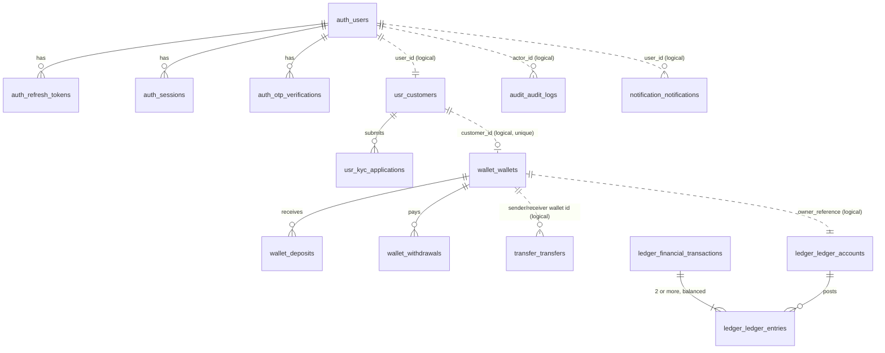

# Database Requirements
**Banking Digital Wallet Platform — consolidated database and financial-domain requirements for the portfolio MVP (PR 2 input)**

| Item | Value |
| ---- | ----- |
| Version | 0.4 — Draft, 2026-10-30 |
| Status | **Requirements only.** No schema is approved by this document; the schema itself is in the Flyway migrations from PR 2, with its protections listed in doc 06 MVP-ADR-02. The recommendations in §11 were **accepted by the owner on 2026-10-30**; decisions whose recommendation is "owner supplies or decides" stay open (§11). Decisions that change doc 06 are recorded there (doc 06 v0.2). A second round of owner decisions (D11, D12, D13, D15, D20, D25) is recorded in doc 06 as MVP-ADR-18 and MVP-ADR-20 to -24, and reflected below |
| Sources | docs 01–05 (target), doc 06 (MVP decision register, **governs**), `CLAUDE.md` |
| Method | Three independent read-only reviews (database reviewer, backend architect, security reviewer), each claim then checked against the source text (§12) |
| Tools | PostgreSQL, Flyway, Testcontainers, ArchUnit: all free and already in the project. No new dependency is required by anything in this document |

**Tags.** Every requirement carries exactly one tag:

| Tag | Meaning |
| --- | ------- |
| **[Documented: doc NN §x]** | stated in docs 01–05 and not changed by doc 06 |
| **[MVP-ADR-nn]** | decided in doc 06 (Approved unless marked *Proposed*) |
| **[Recommendation]** | proposed by the review; not in any document; needs no new value but should be confirmed in the schema plan |
| **[Open → Dnn]** | the documents do not define it, or they conflict; decision Dnn in §11 |

---

## 0. Key findings
1. **The base table definitions are missing.** doc 01 §7.3 is only a *delta* to `FInal/02. ERD.md`, which is not in the repository. Column lists, lengths and most enums must therefore be designed in PR 2 from this document **[Open → D01]**.
2. **Doc 06 resolves the biggest conflicts:**
   - posting is atomic and synchronous, not asynchronous (MVP-ADR-03);
   - one database with a schema per module (MVP-ADR-02);
   - ledger immutability is enforced by a trigger, not by role grants (MVP-ADR-02, MVP-ADR-03).
3. **Several target features become unreachable** under synchronous posting: `PENDING_POST`, transfer `PENDING`/`PROCESSING` and persisted `FAILED` transfers. **Resolved:** the MVP transfer states are `COMPLETED`, `PENDING_REVIEW`, `REJECTED`, `CANCELLED`, `EXPIRED` and `BLOCKED`. Cancel applies only to transfers held for review **[MVP-ADR-03, MVP-ADR-24]**.
4. **Two MVP features have no data path yet:**
   - **Unified history** (MVP-ADR-11) cannot join the `wallet` and `transfer` schemas, because MVP-ADR-02 forbids cross-schema joins. **Resolved:** history pages over the customer's ledger transactions (D06, accepted); held transfers are listed by `GET /api/v1/transfers` (C16).
   - **Transfers** needed a `receiverCustomerId`, but no way to find one was documented. **Resolved:** exact wallet-number lookup **[MVP-ADR-20]**.
5. **Idempotency had no owning schema** for deposits and withdrawals, and no key scope. **Resolved:** one table per money module, with keys unique per `(customer_id, operation, key)` (D02 and D03 accepted; doc 02 §1.4).

## 1. Entities and relationships

### 1.1 Schemas and tables
- One PostgreSQL database with the schemas `auth`, `usr`, `wallet`, `transfer`, `ledger`, `risk`, `audit` and `notification`, and one Flyway stream **[MVP-ADR-02, MVP-ADR-24]**.
- There are no foreign keys or joins across schemas, and a module's repositories touch only its own schema **[MVP-ADR-02]**.
- `transaction` (read-only history) and `admin` have no schema **[MVP-ADR-02, MVP-ADR-11]**.

| Schema (module) | Table | Purpose and documented rules | Tag |
| --------------- | ----- | ---------------------------- | --- |
| `auth` | `users` | unique email and phone; status starts `PENDING_VERIFICATION` and becomes active after OTP verification | [Documented: doc 01 §7.2, §7.7; doc 05 §3.2] |
| | `credentials` | password hash (**Argon2id**), 12–128 characters; failed-login count and locked-until (5 consecutive, 15 minutes) | [Documented: doc 01 §7.2; doc 03 §3.4] [MVP-ADR-23] |
| | `password_history` | the last 5 password hashes; a new password may not match any of them | [MVP-ADR-23] |
| | `refresh_tokens` | hash only, 7 days, rotated, family revoked on reuse | [Documented: doc 03 §3.4] |
| | `sessions` | 30-minute inactivity expiry | [Documented: doc 01 §7.2; doc 02 §2.1] |
| | `otp_verifications` | keyed hash, single-use, 5 min, 5 attempts per challenge; resend count and last-sent time (60 s cooldown, 5 per hour) | [MVP-ADR-06, MVP-ADR-23] [Documented: doc 03 §3.4] |
| | password-reset tokens | expiring, single-use | [Documented: doc 05 §3.2] · storage [Recommendation: hash only, in `auth`] |
| | roles | `CUSTOMER`, `ADMIN`, `COMPLIANCE_OFFICER` | [MVP-ADR-12, *Proposed*] · storage form [Recommendation: a role column or a small role table in `auth`] |
| `usr` | `customers` | logical `user_id`; `dateOfBirth`, `countryCode`; **legal name**, copied from the approved KYC application | [Documented: doc 01 §7.6; doc 02 §2.2] [MVP-ADR-20] |
| | `kyc_applications` | level `BASIC`/`FULL`, document type, document reference, reviewer, rejection reason; one active application per customer | [MVP-ADR-10] [Documented: doc 05 §4] |
| `wallet` | `wallets` | `available_balance`, `reserved_balance` (holds for transfers under review), `version`, status, currency; one per customer (`uq_wallets_customer`); public `wallet_number`: unique, immutable (trigger), random with a check digit | [Documented: doc 01 §6.1, §7.3, §7.4; doc 05 §3.2] [MVP-ADR-20, MVP-ADR-24] |
| | `daily_limit_usage` | per wallet, operation and Asia/Bangkok date: used and reserved amounts, `version`; `CHECK (used >= 0 AND reserved >= 0)`; locked together with the wallet | [MVP-ADR-18, MVP-ADR-22] · table design [Recommendation] |
| | ~~`wallet_limits`~~ | **not created:** limits are read from configuration, by tier, at check time | [Documented: doc 01 §7.2, §7.5] · superseded by [MVP-ADR-18] |
| | `deposits`, `withdrawals` | simulated movements against `SYS-CASH-CLEARING` | [Documented: doc 01 §7.2] [MVP-ADR-13] |
| `transfer` | `transfers` | `amount > 0`, sender ≠ receiver, unique `reference`, idempotency key unique per sender, `(sender_customer_id, idempotency_key)`; `limit_date` (the Asia/Bangkok submission day); receiver found by wallet number; status `COMPLETED`/`PENDING_REVIEW`/`REJECTED`/`CANCELLED`/`EXPIRED`/`BLOCKED`; held and decided timestamps, hold expiry | [Documented: doc 01 §7.2, §7.4] [MVP-ADR-20, MVP-ADR-24] |
| `ledger` | `ledger_accounts` | account type, `owner_reference` → wallet id, seeded system accounts | [Documented: doc 01 §6.3, §7.3, §7.6] |
| | `financial_transactions` | one per posting, unique `transaction_reference`, immutable | [Documented: doc 01 §6.5] [MVP-ADR-03] |
| | `ledger_entries` | `entry_type` DEBIT/CREDIT, `amount > 0`, immutable | [Documented: doc 01 §7.4] [MVP-ADR-03] |
| | `reversals` | correction record plus an offsetting transaction | [Documented: doc 01 §6.5] · in MVP [Open → D17] |
| `risk` | `risk_assessments`, `risk_rule_hits`, `risk_reviews`, `investigations` | score 0–100, band, decision; triggered rules with each rule's score; reviewer, decision, reason, time (append-only); investigation status `OPEN`/`CLOSED`, closing officer, outcome | [MVP-ADR-24] |
| | `sender_risk_state` | one row per sender, locked `FOR UPDATE` during an assessment, so concurrent requests cannot bypass the frequency rule | [MVP-ADR-24] · table design [Recommendation] |
| `wallet` | `lookup_attempts` | user id, client IP, time; read as sliding windows (10/min per user, 30/min per IP); old rows purged | [MVP-ADR-20] · table design [Recommendation] |
| `audit` | `audit_logs` | fields in §9.3; append-only | [Documented: doc 03 §7.2] |
| `notification` | `notifications`, `notification_preferences` | email only in MVP | [Documented: doc 01 §7.2; doc 02 §2.6] |
| `wallet`, `transfer` | idempotency records (one table per money module) | unique `(customer_id, operation, key)`, request hash `varchar(64)`, stored response, rejections included | [Documented: doc 01 §7.3; doc 02 §1.4] · D02, D03, D05 accepted |

**Not in the MVP:**
- `outbox_events`, `processed_events` (no Kafka) **[MVP-ADR-03]**;
- `reservations`, `kyc_documents`, `kyc_verifications`, `beneficiaries`, payment, card and biller tables **[MVP-ADR-10, MVP-ADR-12]**;
- `approvals`, `fraud_alerts` and the RBAC tables (no maker-checker action in the MVP) **[MVP-ADR-12, *Proposed*]**.

### 1.2 Relationships
Cross-schema references are plain id columns with no foreign key **[MVP-ADR-02]**. Within a schema, normal foreign keys apply **[Recommendation]**.

Solid line = foreign key inside one schema; dotted line = logical reference across schemas **[Documented: doc 01 §7.6]**.

### 1.3 Schema-level recommendations
- **[Recommendation]** Set Flyway's default schema explicitly, so `flyway_schema_history` is not created in `public`. Done in PR 2: the history lives in its own `flyway` schema.
- **[Recommendation]** Every customer-owned table carries its owner column (`customer_id` or `user_id`) and an index on it. Owner-scoped queries then implement the identical 404 rule **[MVP-ADR-19]**.
- **[Recommendation]** Migration order:
  1. schemas;
  2. `auth`;
  3. `usr`;
  4. `wallet`;
  5. `ledger` (tables, immutability triggers, system-account seed);
  6. `transfer`, then `risk`;
  7. idempotency;
  8. `audit`;
  9. `notification`.
- **Database roles [MVP-ADR-02]:**
  - `wallet_owner` runs Flyway and owns every schema; `wallet_app` is the non-superuser runtime role.
  - An init script creates both roles before Flyway runs, in Compose and in Testcontainers.
  - `wallet_app` gets `USAGE` on the schemas and DML on ordinary tables through `ALTER DEFAULT PRIVILEGES`.
  - On `ledger.ledger_entries`, `ledger.financial_transactions`, `audit.audit_logs` and `risk.risk_reviews` it gets only `SELECT, INSERT`.

## 2. Financial transaction types
| Type | DEBIT | CREDIT | MVP | Tag |
| ---- | ----- | ------ | --- | --- |
| DEPOSIT | `SYS-CASH-CLEARING` | customer | yes, simulated | [Documented: doc 01 §6.4] [MVP-ADR-13] |
| WITHDRAWAL | customer | `SYS-CASH-CLEARING` | yes, simulated | [Documented: doc 01 §6.4] [MVP-ADR-13] |
| TRANSFER | sender | receiver | yes | [Documented: doc 01 §6.4] |
| REVERSAL | original credit accounts | original debit accounts | no MVP flow triggers it | [Documented: doc 01 §6.4] · [Open → D17] |
| PAYMENT, REFUND, BILL_PAYMENT | — | — | no | [MVP-ADR-12, *Proposed*] |
| FEE | — | — | no (Backlog) | [Documented: doc 01 §6.4] |

- Card funding (`fundingSource: CARD`) is out of scope, and MVP deposits complete synchronously **[MVP-ADR-13]**.
- **A real bank connection is a future step.** The MVP processes no real money; there is no bank, card or biller integration **[MVP-ADR-13]**.
  - **[Recommendation]** Keep the simulation behind the `SYS-CASH-CLEARING` posting templates, so a later bank adapter can replace it without schema changes to the ledger.
  - The future integration will need its own ADR in doc 06, covering:
    - a `PENDING` status for deposits and withdrawals;
    - an external reference column;
    - provider webhooks;
    - reconciliation against bank statements.
- **Simulated deposits create money.** Any KYC-approved customer can add balance up to the daily deposit limit. That is acceptable for a portfolio, as long as deposits are audited and rate-limited (30/min per customer) **[MVP-ADR-06]**.
- **[Recommendation]** The type check on `financial_transactions` admits `DEPOSIT`, `WITHDRAWAL` and `TRANSFER` (plus `REVERSAL` if D17 says so). Adding a value later is an additive migration.

## 3. Wallet and currency
- A wallet is created only on KYC approval, in the same transaction as the approval, with tier limits **[MVP-ADR-10]**.
  - It starts `ACTIVE` with balance 0 and currency THB; there is one per customer and each has a unique wallet number **[Documented: doc 05 §3.2]**.
  - The unique `customer_id` index also makes a concurrent double approval safe **[Documented: doc 01 §7.3]**.
  - Before approval, `GET /wallet` returns `404 WALLET_NOT_FOUND` and money endpoints return `403 KYC_REQUIRED` **[MVP-ADR-10]**.
- **Status** is `ACTIVE`, `FROZEN` or `CLOSED` **[Documented: doc 01 §7.4]**.
  - Frozen wallets cannot transact **[Documented: doc 05 §4]**.
  - A closed wallet is not reactivated "unless policy allows" **[Documented: doc 05 §4]** · the policy and whether `CLOSED` is reachable at all **[Open → D21]**.
  - The customer freezes; staff unfreeze with a reason, audited **[Documented: doc 02 §2.3] [MVP-ADR-12, *Proposed*]**.
- **Balances** are `NUMERIC(19,2)` **[MVP-ADR-21]** and ≥ 0; `CHECK (available_balance >= 0)` is the last guard against overdraft **[Documented: doc 01 §7.4] [MVP-ADR-08]**.
  - `reservedBalance` is in the API contract **[Documented: doc 02 §2.3]**. Reservations for payments are MVP-Ext, but in the MVP it holds amounts of transfers under review **[MVP-ADR-24]**.
  - Keep the column with `CHECK (reserved_balance >= 0)` **[Recommendation]**.
- **Currency** is THB only and always explicit **[Documented: doc 01 §6.5, §7.4; doc 02 §1.6]**.
  - Doc 01 §7.4 calls the THB rule a "configuration check".
  - **[Recommendation]** Also add `CHECK (currency = 'THB')` on every money table. It can be relaxed later by migration.
- **Money values** are `BigDecimal` in code and never floating point **[Documented: doc 01 §7.4]**. Amounts carry **at most 2 decimals**; more are rejected with `400 INVALID_AMOUNT`, never rounded **[MVP-ADR-21]**. PostgreSQL itself would round on assignment, so the rule is enforced in the API and domain layers **[MVP-ADR-21]**.
- **Limits** are configuration, never hard-coded **[Documented: doc 01 §7.5]**.

| Limit | Value | Tag |
| ----- | ----- | --- |
| daily transfer, `BASIC` → Basic | 100,000 THB | [Documented: doc 01 §7.5] |
| daily transfer, `FULL` → Verified | 500,000 THB | [Documented: doc 01 §7.5] |
| Premium (1,000,000) | not offered | [Documented: doc 06 §3, D-05] |
| daily withdrawal | 50,000 THB | [Documented: doc 05 §3.2] |
| daily deposit | 200,000 THB | [Documented: doc 05 §3.2] |
| `MAX_WITHDRAWAL_AMOUNT` | 50,000 = the daily withdrawal limit | [Documented: doc 04 §5] [MVP-ADR-18] |
| transfer: minimum / per transaction | 1.00 / 50,000.00 THB, every tier | [MVP-ADR-18] |
| deposit: minimum / per transaction | 100.00 / 100,000.00 THB | [MVP-ADR-18] |
| withdrawal: minimum / per transaction | 100.00 / 30,000.00 THB | [MVP-ADR-18] |
| limit day | Asia/Bangkok calendar day, reset at midnight Bangkok; timestamps stored in UTC | [MVP-ADR-22] |

  - Failed and cancelled transfers do not consume the daily limit **[Documented: doc 01 §7.5]**. Amounts held for review count until they are released **[MVP-ADR-18, MVP-ADR-24]**.

## 4. Ledger and accounting model

### 4.1 Model
- The ledger is the accounting system of record and the wallet is the operational snapshot. If they disagree, the ledger wins **[Documented: doc 01 §6.1]**.
- **Sign convention:** for customer accounts, CREDIT increases and DEBIT decreases; balance = Σ CREDIT − Σ DEBIT, always derived from the entries **[Documented: doc 01 §6.2]**.
  - The convention is defined only for customer and merchant accounts. Under it `SYS-CASH-CLEARING` goes negative as customers deposit **[Open → D16]**.
- **Account types:** `CUSTOMER`, `MERCHANT`, `SYSTEM`, `FEE`, `SUSPENSE`. Seeded accounts: `SYS-CASH-CLEARING`, `SYS-BILLER-CLEARING`, `SYS-FEE`, `SYS-SUSPENSE`, seeded by Flyway **[Documented: doc 01 §6.3, §7.3]** · which ones the MVP seeds **[Open → D16]**.
- **The customer ledger account** is created on `WalletCreated`, or lazily on the first posting **[Documented: doc 01 §5.3]**.
  - **[Recommendation]** Create it through the ledger application service in the same KYC-approval transaction as the wallet.
  - **[Recommendation]** `UNIQUE (owner_reference)` for `CUSTOMER` accounts and a unique code for system accounts.

### 4.2 Invariants and how they are enforced
| # | Invariant | Tag | Enforcement |
| - | --------- | --- | ----------- |
| 1 | Σ DEBIT = Σ CREDIT per transaction, at least 2 entries | [Documented: doc 01 §6.5] | domain check; **[Recommendation]** plus a deferred constraint trigger checked at commit |
| 2 | amount > 0, currency explicit, THB | [Documented: doc 01 §6.5, §7.4] | `CHECK` constraints |
| 3 | entries and transactions immutable | [MVP-ADR-03] | triggers rejecting `UPDATE`/`DELETE`/`TRUNCATE` on `ledger_entries` and `financial_transactions` (also on `wallet.deposits`, `wallet.withdrawals`, `risk.risk_assessments`, `risk.risk_rule_hits`, `risk.risk_reviews` and `audit.audit_logs`); `wallet_app` has only `SELECT, INSERT` on them. An entry may only join a ledger transaction created in the same database transaction, so a posted transaction never gains entries; postings never run in a savepoint (implemented in V2). This replaces the target's role grants (doc 01 §6.5, doc 03 §4.2 T7, doc 04 §3.4) **[MVP-ADR-02]** |
| 4 | unique `transaction_reference` | [Documented: doc 01 §6.5] | unique constraint · **[Recommendation]** use the business record's unique reference |
| 5 | one DB transaction per posting, the same transaction as the business record | [MVP-ADR-03] | `@Transactional` boundary in the money service |
| 6 | `FROZEN`/`CLOSED` accounts reject new entries | [Documented: doc 01 §6.5] | the `FAILED_POST` outcome is superseded, so such a posting rolls back **[MVP-ADR-03]**; enforced by the entry insert trigger, with `status` defaulting to `ACTIVE` (D16, implemented in V2) |
| 7 | corrections only by reversal; financial records never physically deleted | [Documented: doc 01 §6.5, §7.7; doc 03 §5.2] | no delete path: `wallet_app` cannot delete wallets, movements, transfers, ledger accounts or investigations; only a `PENDING_REVIEW` transfer may change, and only its decision fields **[MVP-ADR-02]** · no `reversals` table in the MVP (D17) |

Trigger hardening, all **[Recommendation]**:
- a statement-level `BEFORE TRUNCATE` trigger, because row triggers do not fire on `TRUNCATE`;
- cover `reversals` too, if that table is created;
- the trigger-bypass risk is a runtime role that owns the tables and can `DISABLE TRIGGER` **[Open → D19]**.
- **[Recommendation]** `ledger_accounts` stores **no** running balance, which avoids a hot, locked `SYS-CASH-CLEARING` row.
- **[Open → D22]** Periodic ledger hash checksums **[Documented: doc 03 §4.2 T7]** are not mentioned in doc 06.

## 5. Balance calculation and reconciliation
- **Wallet snapshot:** updated in place in the same transaction as the posting **[MVP-ADR-03]**.
- **Ledger balance:** derived from the entries **[Documented: doc 01 §6.2]**.
- **Reconciliation:** a scheduled check logs mismatches at ERROR **[MVP-ADR-03; doc 06 §3, D-12]**. It checks that:
  - `available + reserved` = the ledger-derived balance, per wallet;
  - each `COMPLETED` movement has exactly one ledger transaction;
  - `reserved_balance` = Σ of the wallet's `PENDING_REVIEW` transfers;
  - reserved limit usage = the same sum per limit date.
- **What doc 06 narrows:** doc 01 §6.6 also compares `available + reserved`, matches every deposit, withdrawal and transfer with a ledger transaction, and writes `RECONCILED` or an exception record **[Documented: doc 01 §6.6]**. MVP-ADR-03, as amended, keeps the `available + reserved` comparison and per-record matching for `COMPLETED` movements, with log-only output (D18 accepted).
- **No balance fixes:** reconciliation is read-only on history. Discrepancies are never fixed by editing ledger rows or forcing balances **[Documented: doc 01 §6.6; doc 04 §8 RB-3; doc 05 §7.4]**.
- **[Recommendation]** Further checks:
  - the global Σ of all entries per currency is 0;
  - the per-record and reserved checks above, which are now part of MVP-ADR-03.
- **[Recommendation]** Run the check in one read-only `REPEATABLE READ` transaction, so the snapshot and the entries are read from the same point in time.
- **[Recommendation]** Module placement:
  - `wallet` and `transfer` call `ledger` to post. A reconciliation inside `ledger` that reads wallet snapshots would create a module cycle, which ArchUnit forbids.
  - Place it in `admin`, which may call both application services **[Open → D18]**.
- **[Recommendation]** Indexes: `ledger_entries (account_id)` and `(transaction_id)` **[Documented: doc 01 §7.7]**, plus `(account_id, entry_type)` for the derived balance.

## 6. Transaction states and lifecycle
| Entity | Documented states | MVP reality | Tag |
| ------ | ----------------- | ----------- | --- |
| KYC application | `DRAFT → PENDING_REVIEW → APPROVED \| REJECTED`; a rejected customer may re-apply | kept, but "submit requires documents" and documents are out of scope | [Documented: doc 02 §2.2] [MVP-ADR-10] · [Open → D23] |
| Wallet | `ACTIVE`, `FROZEN`, `CLOSED` | as documented | [Documented: doc 01 §7.4] |
| Transfer | `PENDING → PROCESSING → COMPLETED \| FAILED \| CANCELLED`; cancel only while pending | `COMPLETED` (risk allow/monitor); `PENDING_REVIEW` → `COMPLETED` \| `REJECTED` \| `CANCELLED` \| `EXPIRED`; `BLOCKED`. A validation failure leaves no row | [Documented: doc 02 §2.4] [MVP-ADR-03, MVP-ADR-24] |
| Deposit / withdrawal | `PENDING` (card only), otherwise completed | simulated, synchronous; no full enum documented | [Documented: doc 02 §2.3; doc 05 §3.2] · [Open → D10] |
| `ledgerStatus` | `PENDING_POST`, `POSTED`, `FAILED_POST`; column default `PENDING_POST` | always `POSTED`, returned only after commit | [Documented: doc 01 §7.3] [MVP-ADR-03] |
| User | `PENDING_VERIFICATION`, active, locked, frozen, suspended | full enum not documented | [Documented: doc 02 §2.1, §2.7; doc 05 §3.2] · [Open → D20] |

- **[Recommendation]** For KYC, a partial unique index on `customer_id` where status is `DRAFT`, `PENDING_REVIEW` or `APPROVED` enforces "one active application". The applicant ≠ reviewer rule is checked in the service **[MVP-ADR-10]**.
- **[Recommendation]** For `ledgerStatus`: no `PENDING_POST` default. A `CHECK` admitting only `POSTED` until a broker exists; widening it later is additive.
- Business records are immutable, with a unique reference and correlation ID; completed transactions cannot be modified **[Documented: doc 05 §4]**.

## 7. Idempotency
- `Idempotency-Key` (client UUID v4) is required on deposits, withdrawals and transfers **[Documented: doc 02 §1.3]**. It is stored in PostgreSQL **[MVP-ADR-06]**.
- A replay with the same key and body returns the original status and body. The same key with a different body returns `409 IDEMPOTENCY_KEY_REUSED`. Database unique constraints are the final guard **[Documented: doc 02 §1.4]**.
- `request_hash` is `varchar(64)` **[Documented: doc 01 §7.3, §13]**. Transfers have a unique idempotency key **[Documented: doc 01 §7.4]**, scoped per sender as `(sender_customer_id, idempotency_key)`, so another customer's key never collides (doc 03 §4.2 T3).
- Concurrent duplicate requests produce exactly one transfer **[MVP-ADR-06]**.
- Retention:
  - 24 h **[Documented: doc 02 §1.4]**, which fits within "per expiry (≤ 30 days)" **[Documented: doc 03 §8]**;
  - a scheduled job deletes only expired keys (D04 accepted).
- **Decided (D02):** one idempotency table per money module (`wallet`, `transfer`).
- **Decided (D03):** keys are unique per `(customer_id, operation, key)` (doc 02 §1.4).
- **Decided (D05):** business-rule rejections are stored in their own transaction and replayed with their original status (doc 02 §1.4).
- **[Recommendation]** Hash a canonical form of the validated request (fixed amount scale, currency) with SHA-256, so formatting differences don't produce a false 409.
- **[Recommendation]** Insert the record in the **same transaction** as the movement. The unique index then serialises concurrent duplicates. On a violation, re-read the record in a new transaction and replay it; never return 500.
- **[Open → D10]** The deposit body's `reference` **[Documented: doc 02 §2.3]**: its meaning and uniqueness scope. A globally unique client reference would make its 409 reveal other customers' references.

## 8. Concurrency and locking
- **Locking:** `SELECT … FOR UPDATE` on both wallets in ascending id order, plus the `version` check on every snapshot update; `CHECK (available_balance >= 0)` is the last guard **[MVP-ADR-08]**.
- **Version mismatch:** the target reloads and retries a bounded number of times **[Documented: doc 01 §6.8]**. **[Recommendation]** Under the row lock, a version mismatch means a code path skipped the lock: roll back, return `SYSTEM_ERROR` and log at ERROR, without retrying.
- **Required tests:**
  - N concurrent debits never overdraw;
  - opposite-direction transfers do not deadlock;
  - money is conserved;
  - the ledger stays balanced.

  **[MVP-ADR-08]** They address threats T5 and T6 **[Documented: doc 03 §4.2]**.
- **[Recommendation]** Lock in **one SQL statement** (`… WHERE id IN (:a, :b) ORDER BY id FOR UPDATE`), so the database's own uuid order defines the lock order. Sorting UUIDs in Java may not match PostgreSQL's byte order.
- **[Recommendation]** Re-check after the lock: wallet status (freeze races), the balance, and today's limit usage. A limit sum read before the lock lets two requests both pass.
- **One lock order for every money flow** (accepted):
  1. the idempotency row;
  2. the transfer row (review actions only: approve, reject, cancel, expire);
  3. the wallets in ascending id order, in one SQL statement;
  4. the `daily_limit_usage` rows;
  5. customer ledger accounts `FOR SHARE`, taken by the ledger entry trigger;
  6. inserts: ledger, audit and review rows (never locked).

  A flow that changes a ledger account's status (freeze, close) locks the wallet **first**, so it follows the same order and cannot deadlock with a posting (owner, 2026-10-30; PR 2 review; applies from PR 4). System and suspense accounts are not locked, so an in-flight deposit can still post while one is being frozen; accepted, because only operations freeze them.
- The expiry job handles one transfer per transaction with `FOR UPDATE SKIP LOCKED` **[MVP-ADR-24]**.
- **Risk assessment** runs in **its own** database transaction before the money transaction, and locks only the sender's `risk.sender_risk_state` row. It never holds that lock while taking the locks above, so it adds no step to the money-flow lock order (owner, 2026-10-30; PR 2 review).
- **[Recommendation]** Deposits and withdrawals take the same single-wallet `FOR UPDATE`.
- Daily usage is kept in `daily_limit_usage` per wallet, operation and limit date **[MVP-ADR-18]**.
- **[Open → D14]** Lock and statement timeout values.
- The rate limiter is correct only for a single instance **[MVP-ADR-06]**.

## 9. Security and audit (as it affects the data model)

### 9.1 Stored secrets and personal data
| Data | Class | Rule | Tag |
| ---- | ----- | ---- | --- |
| password | Restricted | Argon2id hash only; last 5 hashes kept for the reuse check | [Documented: doc 03 §3.4, §5.1] [MVP-ADR-23] |
| refresh token | Restricted | hash only, family revocation | [Documented: doc 03 §3.4] |
| OTP | Restricted | keyed hash (HMAC-SHA256, secret from an environment variable), never logged | [MVP-ADR-06, MVP-ADR-23] |
| legal name | Confidential | shown to other customers only masked (first name and last-name initial) | [MVP-ADR-20] |
| risk scores, rule hits, reviews | Internal | staff-only, audited | [MVP-ADR-24] |
| reset token | Restricted | single-use, expiring | [Documented: doc 05 §3.2] · **[Recommendation]** hash only |
| KYC document reference | Restricted / KYC content | never logged or returned unmasked | [Documented: doc 03 §5.1] · encryption [Open → D24] |
| email, phone, date of birth | Confidential | masked in UI and logs; field encryption not implemented (documented gap) | [Documented: doc 03 §5.1] [MVP-ADR-12, *Proposed*] |
| balances, transactions | Confidential | owner-only access; identical 404 | [Documented: doc 03 §5.1] [MVP-ADR-19] |

Doc 03 §2.2 requires field-level encryption for "KYC references and phone/email". MVP-ADR-12 waives only phone and email **[Open → D24]**.

### 9.2 What is audited
Logins, password changes, KYC decisions, freeze/unfreeze, money movements and authorisation failures **[Documented: doc 06 §4; doc 03 §7.1]**. Profile updates are also audited **[Documented: doc 02 §2.2]**. MVP additions: wallet lookups, risk decisions, holds, cancels, expiries, reviews, investigations, lockouts and OTP failures **[MVP-ADR-20, MVP-ADR-23, MVP-ADR-24]**.

### 9.3 Audit record
- Fields: `actor, action, resource, resourceId, timestamp, result, IP, device, correlationId, oldValue, newValue`. The record is append-only and auditors have read-only access **[Documented: doc 03 §7.2]**.
  - `device` has no source in the MVP, because devices are out of scope **[Recommendation: nullable]**.
- 7-year retention is a deployment concern in the MVP **[Documented: doc 06 §3, D-08]**.
- The audit row for a money movement is in the same transaction as the movement **[MVP-ADR-03]**. **[Recommendation]** The same applies to KYC approval and wallet creation.
- **[Recommendation]** Audits of failures (authorisation failures, a risk `BLOCK`) are written in a separate transaction (`REQUIRES_NEW`); otherwise the rollback removes them.
- `audit_logs` is append-only through the same triggers and grants as the ledger **[MVP-ADR-02]**.
- **[Recommendation]** `oldValue`/`newValue` never contain hashes, tokens, OTPs or KYC content.
- **[Recommendation]** Indexes `(actor_id, created_at)` and `(resource, resource_id)` **[Documented: doc 01 §7.7]**.

### 9.4 Authorisation that needs data
- The authorisation chain runs: authenticate → role → permission → ownership → account status + KYC level + wallet status → business rules → audit **[Documented: doc 03 §3.3]**.
  - **[Recommendation]** Read the user status from the database on money operations, because an access token stays valid for up to 15 minutes after suspension.
- Admins cannot change balances or modify completed transactions **[Documented: doc 05 §4, §7.4]**.
- **Fraud:** doc 03 §4.3 lists velocity, structuring, mule-account and new-device controls. The MVP scores four starter rules into four bands, with manual review and blocking **[MVP-ADR-24]** · rule values decided in MVP-ADR-24.
- A transfer to a missing, frozen or closed receiver returns the same `404` as the lookup, never `WALLET_FROZEN` **[MVP-ADR-20]**.
- STRIDE threats that bear on the schema: T1–T7, T12, T13, T21–T25 **[Documented: doc 03 §4.2]**.
  - T8, T11 and T26 are replaced by "no `/internal/**`" **[MVP-ADR-04]**.

## 10. Missing and conflicting requirements
| # | Conflict or gap | Side A | Side B | Resolution |
| - | --------------- | ------ | ------ | ---------- |
| C1 | Ledger immutability | role without UPDATE/DELETE (doc 01 §6.5; doc 03 §4.2 T7; doc 04 §3.4) | trigger, single application role (MVP-ADR-02, MVP-ADR-03) | doc 06 governs; amended to two roles (migration owner and runtime) → D19 |
| C2 | Posting timing | asynchronous, `PENDING_POST`, degraded mode (doc 01 §4.2, §6.6; doc 05 §4) | atomic, always `POSTED` (MVP-ADR-03) | doc 06 governs |
| C3 | Reconciliation | available + reserved, per-record matching, exception records (doc 01 §6.6) | `available + reserved` vs ledger, per-record matching of `COMPLETED` movements, log at ERROR (MVP-ADR-03, amended) | resolved |
| C4 | Failed transfers | `FAILED (RISK_BLOCKED)` row (doc 01 §4.2) | any failure rolls back (MVP-ADR-03) | → D08 |
| C5 | Transfer cancel and states | cancel while pending (doc 02 §2.4; doc 05 §3.2) | nothing pending is ever committed (MVP-ADR-03) | → D09 |
| C6 | Single limits | response fields `singleTransfer`, `singleWithdrawal` (doc 02 §2.3) | MVP-ADR-18 names `singleTransfer`, `singleDeposit`; `MAX_WITHDRAWAL_AMOUNT` (doc 04 §5) | → D12 |
| C7 | Idempotency owner | `idempotency_records` only in the transfer database (doc 01 §7.2) | deposits and withdrawals need keys too (doc 02 §1.3); no cross-schema access (MVP-ADR-02) | → D02 |
| C8 | History | unified paged history (MVP-ADR-11) | no `transaction` schema, no cross-schema joins (MVP-ADR-02) | → D06 |
| C9 | KYC reference encryption | field-level encryption (doc 03 §2.2) | only phone/email waived (MVP-ADR-12) | → D24 |
| C10 | KYC submit | requires documents and face verification (doc 02 §2.2) | documents and face verification out of scope (MVP-ADR-10) | → D23 |
| C11 | KYC upgrade | a later `FULL` approval upgrades limits (doc 01 §4.1) | one active application (doc 05 §4) | → D23 |
| C12 | KYC decision role | `ADMIN` (doc 02 §2.7) | `COMPLIANCE_OFFICER` (MVP-ADR-12, *Proposed*) | decided with MVP-ADR-12 |
| C13 | Audit immutability | append-only `audit_logs` (doc 03 §2.2, §7.2) | trigger named only for ledger (MVP-ADR-03) | → D19 |
| C14 | Recipient | `receiverCustomerId` required (doc 02 §2.4) | beneficiaries out of scope (MVP-ADR-12); no lookup documented | resolved: lookup by exact wallet number (MVP-ADR-20) |
| C16 | History of held transfers | ledger-based history (D06) | held, rejected, cancelled, expired and blocked transfers have no ledger entries (MVP-ADR-24) | `GET /api/v1/transfers` lists every state; `GET /api/v1/transactions` shows completed movements |
| C15 | Missing sources | `FInal/02. ERD.md` (base columns), `FInal/03` (OpenAPI schemas), `11/03`, `11/04`, docs 09, 19, 21, 22, BR §n, TXN-04, PROFILE-01 | not in the repository | → D01 |

**Outside the database scope (found during review; for the PR noted):**
- Registration returns `409` for a duplicate email (doc 02 §2.1), which reveals that an account exists, unlike the generic login and forgot-password responses. **PR 3.**
- `ErrorCode` assigns HTTP statuses that no document defines: `WALLET_FROZEN` and `SELF_TRANSFER` → 409, `RISK_BLOCKED` → 403. Doc 03 §3.3 treats wallet status as authorisation, which suggests 403. Its Javadoc still says the generic codes are "pending approval", although MVP-ADR-19 is approved. **PR 4/5.**
- The precedence of errors when several checks fail (balance, single limit, daily limit), and `INVALID_AMOUNT`/`CURRENCY_MISMATCH` vs `VALIDATION_ERROR`. **PR 4.**

## 11. Unresolved decisions
"Needed by" refers to the project's PR sequence: 2 database and domain, 3 auth and authorization, 4 KYC and wallet, 5 transfers, history, audit and reconciliation.

**Owner decision, 2026-10-30:** the recommendation in each row is **accepted**, except D08 and D09, which MVP-ADR-24 superseded later the same day. The second review round (B1–B10) is recorded in doc 06.
- **Decided by the owner later the same day:** D11 (MVP-ADR-20), D12 (MVP-ADR-18), D13 (MVP-ADR-22), D15 (MVP-ADR-21), D20 (MVP-ADR-23) and D25 (MVP-ADR-24).
- **D26–D28** were decided by the owner afterwards (MVP-ADR-20, MVP-ADR-24). No owner values are open.
- **Recorded in doc 06 (2026-10-30):**
  - D07: MVP-ADR-07 approved;
  - D09: an amendment to MVP-ADR-03;
  - D19: an amendment to MVP-ADR-02;
  - D22 and D24: entries in the doc 06 §4 and MVP-ADR-12 gap lists.

  D03 and D05 are also recorded in doc 02 §1.4.

| ID | Question | Options | Recommendation | Needed by |
| -- | -------- | ------- | -------------- | --------- |
| D01 | Base columns are missing (`FInal/02. ERD.md`) | (a) the owner supplies the ERD; (b) PR 2 designs the columns from this document | (b), with the column list reviewed in the PR 2 schema plan | PR 2 |
| D02 | Where idempotency records live | (a) one table in `transfer`; (b) one table per money module (`wallet`, `transfer`); (c) a shared schema | (b): each module owns its keys, which keeps MVP-ADR-02 intact | PR 2 |
| D03 | Idempotency key scope | global, or `(customer_id, operation, key)` | `(customer_id, operation, key)`: prevents cross-customer replay | PR 2 |
| D04 | Idempotency expiry and purge | 24 h (doc 02 §1.4) up to 30 days (doc 03 §8); purge job or none | 24 h; a scheduled job deletes only expired keys; unique constraints on business records stay the final guard | PR 4 |
| D05 | Store rejected (4xx) outcomes for replay? | (a) roll back, the retry runs again; (b) store business-rule rejections in a separate transaction | (b) matches doc 02 §1.4. Reviewers split: the architect preferred (a) | PR 4 |
| D06 | Source for unified history (MVP-ADR-11) | (a) merge module queries in memory; (b) page over the customer's ledger transactions through the ledger application service; (c) a history table in a new `transaction` schema (amends MVP-ADR-02) | (b): the ledger already holds every movement, so no new schema is needed | PR 5 |
| D07 | MVP-ADR-07 domain purity (*Proposed*) | approve / reject | approve; the current ArchUnit domain rule needs a `jakarta.persistence`/Spring check and self-test | PR 2 |
| D08 | Persist failed transfers (risk `BLOCK`)? | (a) roll back plus an audit row in its own transaction; (b) a `FAILED` transfer row in its own transaction | **superseded by MVP-ADR-24:** a validation failure leaves no row; a risk `BLOCK` keeps a `BLOCKED` row and opens an investigation | PR 5 |
| D09 | Transfer states and the cancel endpoint | (a) drop `PENDING`/`PROCESSING`/`CANCELLED` and cancel from the MVP; (b) keep them in the schema, unused | **superseded by MVP-ADR-24:** `CANCELLED`, and cancel while `PENDING_REVIEW`, are part of the MVP | PR 5 |
| D10 | Deposit/withdrawal status enum and the deposit `reference` field | define enum; client `reference` unique or free text | status `COMPLETED` only; server-generated unique reference; client `reference` stored as a free-text note | PR 4 |
| D11 | How a sender identifies the receiver | lookup by wallet number, phone or email; or beneficiaries back in scope | **decided:** exact wallet-number lookup, masked name and number (MVP-ADR-20) | PR 4 |
| D12 | Single limits and `MAX_WITHDRAWAL_AMOUNT` (MVP-ADR-18) | owner supplies values; map fields | **decided:** values in MVP-ADR-18; daily transfer limits stay tiered | PR 4 |
| D13 | Limit day boundary | UTC or Asia/Bangkok | **decided:** Asia/Bangkok; held transfers count on their submission day (MVP-ADR-22) | PR 4 |
| D14 | Lock and statement timeouts | values | set in configuration in PR 5, with concurrency tests | PR 5 |
| D15 | Amount precision | up to 4 decimals (doc 02 §1.6), or 2 for THB | **decided:** `NUMERIC(19,2)`, more than 2 decimals rejected (MVP-ADR-21) | PR 2 |
| D16 | System accounts: seeds, sign, status | seed all four or only `SYS-CASH-CLEARING`; status column | seed `SYS-CASH-CLEARING` and `SYS-SUSPENSE`; no ≥ 0 check on `SYSTEM` accounts; status column defaulting to `ACTIVE` | PR 2 |
| D17 | Reversals in the MVP | schema only; an operator path; none | none: no `reversals` table until an approved reversal path exists. Reversing a transfer can overdraw the receiver | PR 2 |
| D18 | Reconciliation output, scope and placement | log only or exception table; `admin` or `ledger` | log only; the checks as amended in MVP-ADR-03, plus Σ = 0; placed in `admin`; interval set in configuration | PR 5 |
| D19 | Database roles and trigger scope | single role (MVP-ADR-02); separate Flyway owner and runtime roles; trigger also on `audit_logs` | separate owner and runtime roles (free, closes the trigger-bypass risk; amends MVP-ADR-02); immutability trigger on `audit_logs` too | PR 2 |
| D20 | Auth values not in the docs | lockout duration, password policy, password-history depth, resend-OTP limit, full user status enum | **decided:** MVP-ADR-23 (Argon2id with Bouncy Castle approved). The full user status enum is still designed in the PR 3 plan | PR 3 |
| D21 | Wallet `CLOSED` | reachable or not; reactivation policy | not reachable in the MVP; status kept in the `CHECK` | PR 4 |
| D22 | Ledger hash checksums (doc 03 §4.2 T7) | implement or record a gap | record as a gap in doc 06 §4 | PR 2 |
| D23 | KYC flow without documents | keep `DRAFT` + submit, or create directly as `PENDING_REVIEW`; BASIC → FULL upgrade | keep `DRAFT` + submit with the document type and reference; upgrade out of the MVP | PR 4 |
| D24 | KYC document reference protection | encrypt (application-side AES or `pgcrypto`, both free); or add to the gap list | add to the MVP-ADR-12 gap list, and never log or return it unmasked | PR 4 |
| D25 | Risk `REVIEW` threshold (MVP-ADR-12) | value | **decided:** score bands and manual review (MVP-ADR-24) | PR 5 |
| D26 | Wallet-lookup rate limit (MVP-ADR-20) | requests per user per minute | **decided:** 10/min per user and 30/min per IP, sliding windows in PostgreSQL, `429` with `Retry-After` | PR 4 |
| D27 | Risk rule thresholds and weights (MVP-ADR-24) | values for amount, velocity window and count, new recipient, new wallet | **decided:** weight table in MVP-ADR-24; a failed evaluation rejects the transfer, never score 0 | PR 5 |
| D28 | Review hold expiry (MVP-ADR-24) | duration | **decided:** 24 hours from entering `PENDING_REVIEW`, warning to compliance officers at 12 hours, no extension | PR 5 |
| — | Pending *Proposed* ADRs: MVP-ADR-12, -14 (MVP-ADR-07 and -18 are now approved) | approve / change | decide before the PR named in each; MVP-ADR-24 needs the `COMPLIANCE_OFFICER` role from MVP-ADR-12 | PR 3–5 |

## 12. Review record
Three reviews ran independently (none saw the others' output); every citation was then checked against the documents.

- **Database reviewer:** a general-purpose agent with the new `database-reviewer` instructions, since the new agent couldn't be loaded mid-session.
- **Backend architect:** `backend-engineer` in analysis-only mode. `git status` stayed clean, so it edited nothing.
- **Security reviewer:** `security-reviewer`.

| Item | Result |
| ---- | ------ |
| All three: missing base ERD, single limits, transfer cancel/states, history paging, idempotency owner and scope, ledger-role vs trigger | confirmed |
| Database: Flyway history table would land in `public` | confirmed (`application.yaml` sets only `locations`) |
| Architect: reconciliation in `ledger` creates a module cycle | confirmed by reasoning: `wallet`/`transfer` call `ledger` to post |
| Architect: "never edit balances" cited as doc 05 §7.3 | **corrected**: the rule is in doc 05 §7.4 and doc 04 §8 RB-3 |
| Architect: `ErrorCode` statuses and stale Javadoc | confirmed (`ErrorCode.java`, lines 10, 24–30) |
| Security: ledger role INSERT/SELECT only cited as doc 04 §3.3 | **corrected**: doc 04 §3.4 |
| Security: KYC references need field-level encryption | confirmed (doc 03 §2.2) |
| Security and database: Java vs PostgreSQL UUID order | kept as a **recommendation** only (lock in one SQL statement), because it is safe whatever the Java ordering is |
| Reviewers split on D05 (store rejected outcomes) | recorded as a split; recommendation follows doc 02 §1.4 |
